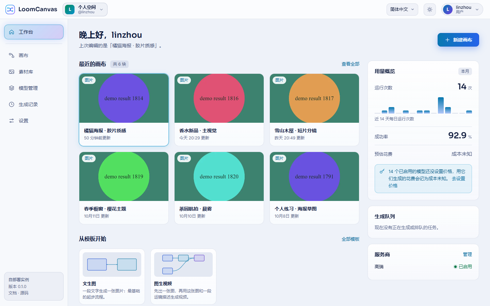
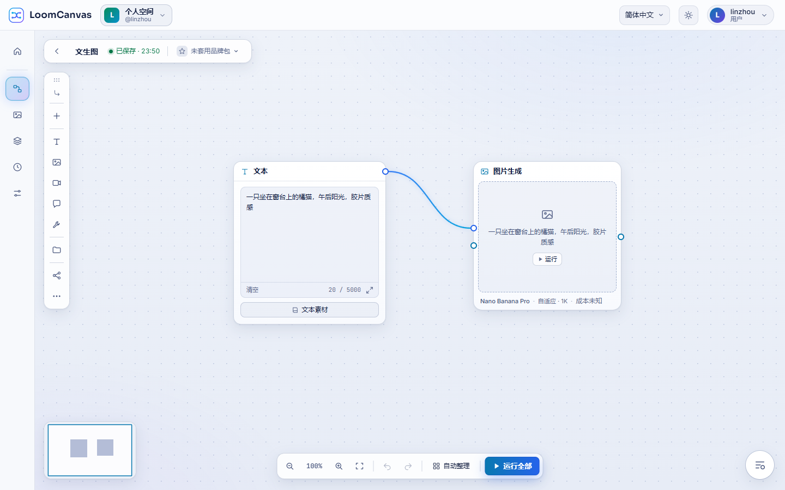

# LoomCanvas

**Open-source, self-hosted node-based AI canvas for image and video generation: wire prompts, reference images and models into a visual workflow, run it in one click, and bring your own API keys.**

[](https://loomcanvas.gaorui.cc)
[](LICENSE)
[](docs/deployment.md)
[](docs/development.md)
[](docs/development.md)
[](README.zh-CN.md)

[Live demo](https://loomcanvas.gaorui.cc) · [简体中文](README.zh-CN.md) · [Documentation](docs/README.md) · [Quick start](#quick-start) · [Supported models](#supported-models) · [Screenshots](#screenshots)

**Try it online: <https://loomcanvas.gaorui.cc>**. Sign up, add your own API key and start a canvas. One key from [Gaorui](https://gaorui.cc) covers image, video and chat models.


## What it is

LoomCanvas is an infinite canvas on which text, images, videos and AI models are nodes, and connections carry the data from one to the next: text-to-image, image editing, image-to-video, video editing and language-model steps in one visual workflow. You run it on your own server with Docker Compose and use your own API keys; it ships no models and sells no credits.

> Status: early development. Interfaces may change before the first tagged release. The built-in Gaorui models have been run against the real service; the OpenAI and Google Gemini integrations follow the official documentation but have not been run by the project. The S3 storage driver is tested against MinIO only, and has not been run against AWS S3, Cloudflare R2 or Aliyun OSS.

## Highlights

- **Node-based workflows**: text, image, image set and video sources; image generation, image edit, video generation, video edit, language model and video analysis nodes.
- **Run a node, a branch or the whole canvas**, or a batch over a set of images; runs are queued and carry on after a server restart.
- **Bring your own key (BYOK)**: Gaorui, OpenAI and Google Gemini built in, more models addable as custom models.
- **Cost estimates instead of credits**: a per-run estimate from your own price table, and usage by day and by model.
- **Your files in your own storage**: local disk, or an S3-compatible bucket (AWS S3, Cloudflare R2, Aliyun OSS, MinIO).
- **Free local tool nodes**: slice, collage, resize, watermark and multi-platform export run on your own server.
- **Templates, brand kits, an asset library** and read-only share links.
- **Team spaces**: shared canvases and assets, keys set up once by the owner, view or edit per canvas, invite links, monthly limits.
- **Accounts**: registration and sign-in, a personal space for every account, a built-in super admin.
- **Embeddable**: mount the whole app, or only the canvas editor, inside your own product.
- **Chinese and English**, dark and light themes, a phone layout and touch gestures.
- **One `docker compose up`**: Vue 3 + Vue Flow front end, Node.js + Express + MongoDB back end.

## Supported models

| Provider | Kind | Models |
| --- | --- | --- |
| **Gaorui** | Image | Nano Banana Pro, Nano Banana 2, Nano Banana 2.1, Nano Banana 2 Lite |
| | Video | Veo 3.1, Grok Video 1.5, Grok Video 1.0, Omni Flash |
| | Video edit | Omni Flash Edit |
| | Chat (LLM) | DeepSeek V4 Pro, GPT 5.5, GLM 5.3, GPT 6 Astra, Gemini 3.5 Flash |
| **OpenAI** | Image | GPT Image 2.5 Sunburst, GPT Image 2.5 Flare, GPT Image 2 (`gpt-image-2`) |
| | Chat (LLM) | GPT-6 Astra, GPT-6.1 Sol, GPT-6 Sol, GPT-6 Luna, GPT-5.6 Sol, GPT-5.6 Terra, GPT-5.6 Luna, GPT-5.5, GPT-5.4, GPT-5.4 Mini, GPT-5.2, GPT-4.1, GPT-4.1 Mini, GPT-4o, GPT-4o Mini |
| **Google Gemini** | Image | Nano Banana 2.1, Gemini 3 Pro Image (Nano Banana Pro), Gemini 3.1 Flash Image (Nano Banana 2), Gemini 3.1 Flash Lite Image (Nano Banana 2 Lite) |
| | Chat (LLM) | Gemini 3.8 Flash, Gemini 3.6 Flash, Gemini 3.5 Flash-Lite, Gemini 3.1 Pro (preview), Gemini 3 Flash (preview) |

- One Gaorui key covers its image, video and chat models. OpenAI and Google Gemini are called through their official APIs only.
- Image models generate from a prompt and edit with reference images. Video generation models do text-to-video and image-to-video; Veo 3.1 and Omni Flash also take a first and a last frame. Chat models drive the Language model node; Gemini 3.5 Flash (Gaorui) also reads video, for the Video analysis node.
- Another image or chat model of the same vendor can be added by name as a custom model. Another vendor needs a provider module: see [Writing a provider](docs/writing-a-provider.md).
- Model names sent upstream, reference-image limits, aspect ratios, resolutions and durations: [Providers](docs/providers.md).

## How it compares

LoomCanvas is node-based, like ComfyUI, but it does not run models on your own machine: every generation node calls a hosted model through its API, so no local GPU is needed, and local model files cannot be loaded. Results appear on the nodes of the canvas. It runs on your own server with your own API keys rather than as a hosted service, and several people can share a team space.

## Quick start

You need Docker with Compose v2.

```bash
git clone https://github.com/gaoruitech/genrelay-loomcanvas.git loomcanvas
cd loomcanvas
cp .env.example .env
# edit .env: set SECRET_KEY to a long random string, and ADMIN_PASSWORD to the super admin's password
docker compose up -d
```

Open http://localhost:3000 (or the host's address, with the `PORT` you set), click **Sign in**, sign in as `admin` with the password you set, and add a provider on the page that follows. The recommended one is Gaorui; get a key at https://gaorui.cc.

- `SECRET_KEY` encrypts your provider API keys in the database. Keep it safe and do not change it afterwards, or the saved keys can no longer be decrypted.
- `PUBLIC_URL` is optional. Leave it empty for local or LAN use: files are addressed relative to whatever address the app is opened at. Set it to the instance's public address so that upstream models can fetch reference media by URL (needed for video inputs, and for reference images with the Gaorui image models, when files are kept on the local disk).
- The super admin account is created by the server at the first start; nobody registers as it. Its username is `admin` unless you set `ADMIN_USERNAME`. `ADMIN_PASSWORD` (8 to 128 characters) is its password. If you leave it empty, a random password is generated and printed once in the start-up log (`docker compose logs app`); sign in with it and you are asked to choose your own. These variables are read only when the account is created.
- Other people click **Sign up** and get ordinary accounts. Registration is open by default; the super admin can close it under **Settings → Site**, or you can start with `REGISTRATION_OPEN=false`. See [Accounts](docs/getting-started.md#accounts).

Step by step: [Getting started](docs/getting-started.md).

## Screenshots

| | |
| --- | --- |
|  Landing page |  Sign in |
|  Adding the first provider after the first sign-in |  Workbench |
|  Editor (Chinese interface) |  Editor (English interface) |
|  The built-in "Image to video" template |  Results on the canvas |
|  Models: providers, models and prices (none are shipped; you enter your own) |  History: every run, with totals |
|  The space switcher: personal space and teams |  Team home |
|  Team: members and invite links |  While somebody else is editing: read-only, with Take over |
|  Light theme: the workbench |  Light theme: the editor |

## Features in detail

<details>
<summary>Everything the canvas, the runs, the models, storage, accounts and teams do today</summary>

- **Canvas editor.** Source nodes (text, image, image set, video), generation nodes (image generation, image edit, video generation, video edit, language model, video analysis), an output node, and groups. Typed connections, undo/redo, copy and paste, auto layout, node search. Three layouts for the generation nodes (result first, compact with a side panel, everything on the node), and a toolbar to align, group and run several selected nodes at once. The tool palette and the run-queue button can be dragged elsewhere on the canvas; select a node and type, and the text goes into its prompt (through an input method too).
- **Local tool nodes.** Slice, collage, resize, watermark and multi-platform export run on your own server and cost nothing.
- **Run orchestration.** Run a single node, a branch or the whole canvas; batch runs over a set of source images. Runs are queued with a concurrency limit and hard timeouts. After a server restart, queued runs and runs that already have an upstream task carry on.
- **Bring your own models.** Pick a provider and enter your own API key. Built in: Gaorui (one key for image, video and chat models), OpenAI (chat, image generation and editing) and Google Gemini (image and chat), the last two through their official APIs. Which models each provider supports is listed explicitly; a model that is not listed can be added as a custom model.
- **Cost, not credits.** An estimate per run from a price table you maintain, shown as "Cost unknown" until you enter prices, plus usage records by day and by model.
- **Your files stay with you.** Results are copied into your own storage: the local disk by default, or an S3-compatible bucket (AWS S3, Cloudflare R2, Aliyun OSS, MinIO), configured under **Settings → Storage**. The bucket can stay private. See [Storage](docs/storage.md) for what has been tested.
- **Templates, brand kits, asset library, share links.** Read-only share links with expiry and revocation.
- **Workbench, history, model management.** A start page with your recent canvases, templates, the queue and this month's usage; a History page with every run, filters, run details, CSV export and the results of several runs as one ZIP; a Models page for providers, models and prices.
- **Can be built into your own product.** Your developers mount the whole app inside their own page (your own sign-in, optional shell, pages and features switched one by one), or embed only the canvas editor behind an adapter backed by your own server. See [Integration](docs/integration.md) and [`examples/`](examples/README.md).
- **Chinese and English** interface and server messages. Dark and light themes, or follow the system. The landing page, the app and the editor rearrange themselves for a phone-sized screen: navigation at the bottom, and in the editor the input bar, the side panel and the run queue become bottom sheets. On a touch screen the canvas pans with one finger and zooms with a pinch, pressing and holding a button shows what it does, and the palette (except on a phone) and the run-queue button can be dragged with a finger or a pen. It suits viewing, small edits and running; for building a complex canvas a larger screen is still more comfortable.
- **Accounts.** People register and sign in; each account has its own personal space: its own canvases, files, providers and API keys. The super admin account is built in: the server creates it at the first start. It manages the site and the list of accounts and can close registration.
- **Teams.** Several accounts share one team space: canvases, assets, brand kits, templates and run history are kept together. The owner and admins set up providers and keys once; members use them and never see a key. Canvases have three levels of visibility (only me, team can view, team can edit); people join with an invite link; monthly limits in runs and in estimated amount, per member and per team; usage figures and an activity log. Creating a team needs the super admin's authorisation. See the [user guide](docs/user-guide.md#teams).
- **What teams are not.** Not real-time collaboration: one person edits a canvas at a time, the others see it read-only and can take over. No email: an invite is a link you pass on yourself. Amounts are estimates from the prices you entered, not bills. And the separation between accounts and between teams is not a hardened multi-tenant boundary. See [Security](docs/security.md).

</details>

## Documentation

| | |
| --- | --- |
| [Getting started](docs/getting-started.md) | From zero to the first image |
| [User guide](docs/user-guide.md) | Using the canvas |
| [Deployment](docs/deployment.md) | Docker, reverse proxy, backups, upgrades |
| [Configuration](docs/configuration.md) | Environment variables and settings |
| [Storage](docs/storage.md) | Local disk or an S3-compatible bucket |
| [Providers](docs/providers.md) | Providers, supported models, custom models, pricing |
| [Security](docs/security.md) | Hardening and limits |
| [FAQ](docs/faq.md) | Common problems |
| [Development](docs/development.md) | Working on the code |
| [Integration](docs/integration.md) | Building LoomCanvas into your own product: the whole app, or only the editor |
| [Writing a provider](docs/writing-a-provider.md) | Adding another vendor |
| [Billing hook](docs/billing-hook.md) | Metering and limits |
| [HTTP API](docs/api.md) | Endpoint reference |
| [Architecture](docs/architecture.md) | Frontend/backend contract (Chinese) |
| [Changelog](CHANGELOG.md) | What changed |

All pages: [docs/README.md](docs/README.md).

## Development

Requires Node.js 20.9+ and MongoDB 7.

```bash
# backend
cd server && npm install && cp .env.example .env   # then set SECRET_KEY in server/.env
npm run dev                                        # http://localhost:3000

# frontend, in another terminal
cd web && npm install && npm run dev               # http://localhost:5173, proxies /api to :3000
```

See [Development](docs/development.md).

## Integration

LoomCanvas runs on its own, and it can also be built into another web product, in one of two shapes:

- **The whole app**, mounted inside an element of your page: your own sign-in, LoomCanvas' top bar and sidebar or none, pages and features switched on and off one by one.
- **Only the canvas editor**, as a function, a Vue component or a custom element, behind an adapter you supply: backed by the stock server, by your own server, or by no server at all.

Both entries are built from this repository (nothing is published to npm). See [Integration](docs/integration.md) and the examples in [`examples/`](examples/README.md). A product that cannot be released under the AGPL needs the commercial license (see [License](#license)).

## License

LoomCanvas is dual-licensed:

- **AGPL-3.0** — free to use and modify. If you run a modified version as a network service, you must publish your changes. See [LICENSE](LICENSE).
- **Commercial license** — for closed-source use or embedding in proprietary products. See [COMMERCIAL.md](COMMERCIAL.md).

"LoomCanvas" and its logo are trademarks and are not covered by the code license. See [TRADEMARK.md](TRADEMARK.md). Third-party software is listed in [THIRD_PARTY_NOTICES.md](THIRD_PARTY_NOTICES.md).

## Contributing

Contributions are welcome under the [Contributor License Agreement](CLA.md). See [CONTRIBUTING.md](CONTRIBUTING.md). To report a vulnerability, see [SECURITY.md](SECURITY.md).
