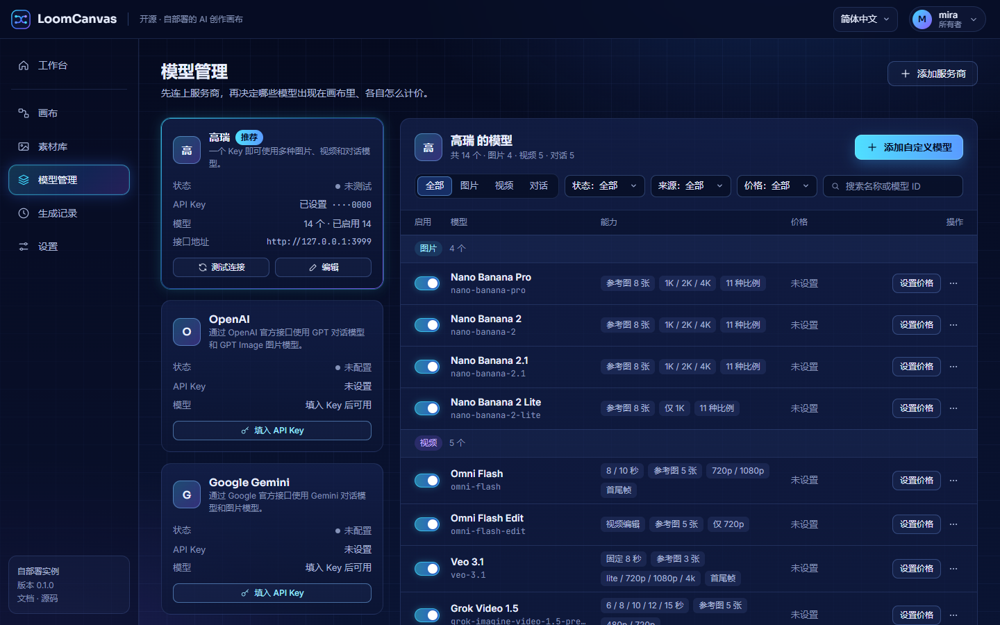

# LoomCanvas

[English](README.md)

开源、可自己部署的 AI 创作无限画布。把文字、图片和模型用连线串起来，一键跑完整个流程，产出图片和视频。

LoomCanvas 不卖积分，也不自带模型。你填自己的 API Key，画布告诉你每一步大概花多少钱，并记录用量。

> 状态：早期开发中。首个正式版本发布前，接口可能调整。内置的模型接入是对着假上游测试的，在本项目里还没有对着真实服务跑过；S3 存储驱动只对着 MinIO 验证过，没有对着 AWS S3、Cloudflare R2、阿里云 OSS 跑过。


## 功能

- **画布编辑器。** 素材节点（文本、图片、图片集合、视频）、生成节点（图片生成、图片编辑、视频生成、视频编辑、大语言模型、视频分析）、成品节点和分组。连线分类型，支持撤销重做、复制粘贴、自动整理、节点搜索。
- **本机工具节点。** 切片、拼图、改尺寸、加水印、多平台导出，在你自己的服务器上处理，没有成本。
- **运行编排。** 运行单个节点、一条分支或整张画布；对一批素材图做批量运行。运行会排队，有并发上限和硬性超时。服务端重启后，排队中的运行和已经拿到上游任务号的运行会接着跑。
- **自带模型。** 模型接入是插件。内置：高睿 API（一个 Key 用图片、视频和对话模型）、任意 OpenAI 兼容接口（对话和文生图）、Google Gemini（图片和对话）。
- **显示成本，不用积分。** 按你自己维护的价格表预估每次运行的成本，没填价格时显示「成本未知」；按天、按模型的用量记录。
- **文件留在你手里。** 结果会转存到你自己的存储：默认本地磁盘，也可以是 S3 兼容的桶（AWS S3、Cloudflare R2、阿里云 OSS、MinIO），在「设置 → 存储」里配置。桶可以保持私有。哪些经过了测试，见[存储](docs/storage.zh-CN.md)。
- **模板、品牌包、素材库、分享链接。** 只读分享链接，可设有效期，可撤销。
- **中英文**界面和服务端提示；浅色、深色主题。
- **按单用户设计。** 一个可选的共用访问口令。没有账号，没有多租户隔离。

## 截图

| | |
| --- | --- |
|  编辑器 |  画布上的结果 |
|  深色主题 |  首次使用的引导页 |
|  模型与价格（示例价格） |  英文界面 |

## 快速开始

需要 Docker 和 Compose v2。

```bash
git clone https://gitee.com/jishulin/loomcanvas.git
cd loomcanvas
cp .env.example .env
# 编辑 .env：把 SECRET_KEY 设成一串足够长的随机字符
docker compose up -d
```

打开 http://localhost:3000 （或这台机器的地址，端口是你设的 `PORT`），按引导页连接一个模型接入即可开始使用。推荐高睿 API，在 https://gaorui.cc 获取 Key。

- `SECRET_KEY` 用来加密数据库里保存的上游 API Key。请妥善保存，设置后不要再改，否则已保存的 Key 将无法解密。
- `PUBLIC_URL` 可以不填。本机或内网使用时留空即可：文件按「当前打开的地址」寻址。实例有公网地址时把它设成那个地址，上游模型才能按地址读取参考素材（文件存在本地磁盘上、又要用视频做输入时需要）。
- 别人也能访问这台机器时，请设置 `ACCESS_PASSWORD`。

逐步说明见[快速上手](docs/getting-started.zh-CN.md)。

## 文档

| | |
| --- | --- |
| [快速上手](docs/getting-started.zh-CN.md) | 从零到第一张图 |
| [使用指南](docs/user-guide.zh-CN.md) | 画布怎么用 |
| [部署](docs/deployment.zh-CN.md) | Docker、反向代理、备份、升级 |
| [配置](docs/configuration.zh-CN.md) | 环境变量与设置 |
| [存储](docs/storage.zh-CN.md) | 本地磁盘或 S3 兼容的桶 |
| [模型接入](docs/providers.zh-CN.md) | 接入类型、模型、价格 |
| [安全](docs/security.zh-CN.md) | 部署加固与局限 |
| [常见问题](docs/faq.zh-CN.md) | 常见问题 |
| [开发](docs/development.zh-CN.md) | 参与开发 |
| [编写模型接入](docs/writing-a-provider.zh-CN.md) | 接入一种新的上游接口格式 |
| [计费钩子](docs/billing-hook.zh-CN.md) | 计量与限额 |
| [HTTP 接口](docs/api.zh-CN.md) | 接口索引 |
| [架构与接口约定](docs/architecture.md) | 前后端约定 |
| [变更记录](CHANGELOG.md) | 改了什么 |

全部文档见 [docs/README.zh-CN.md](docs/README.zh-CN.md)。

## 开发

需要 Node.js 20.9 以上和 MongoDB 7。

```bash
# 后端
cd server && npm install && cp .env.example .env   # 然后在 server/.env 里设置 SECRET_KEY
npm run dev                                        # http://localhost:3000

# 前端，另开一个终端
cd web && npm install && npm run dev               # http://localhost:5173，/api 代理到 :3000
```

详见[开发](docs/development.zh-CN.md)。

## 协议

LoomCanvas 采用双协议：

- **AGPL-3.0**：可以免费使用和修改。如果你把修改后的版本作为网络服务对外提供，必须公开你的修改。见 [LICENSE](LICENSE)。
- **商业授权**：用于闭源使用或嵌入到专有产品中。见 [COMMERCIAL.md](COMMERCIAL.md)。

"LoomCanvas" 名称和 Logo 是商标，不随代码协议授权。见 [TRADEMARK.md](TRADEMARK.md)。第三方软件列在 [THIRD_PARTY_NOTICES.md](THIRD_PARTY_NOTICES.md)。

欢迎贡献代码，贡献前需同意[贡献者协议](CLA.md)。详见 [CONTRIBUTING.md](CONTRIBUTING.md)。报告漏洞请看 [SECURITY.md](SECURITY.md)。
