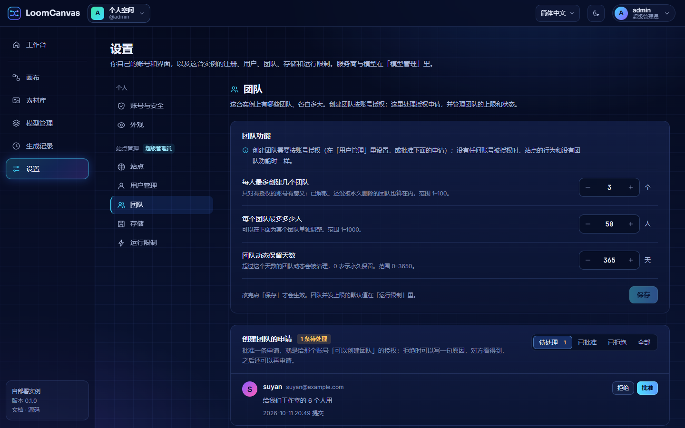

# 配置

[English](configuration.md)

LoomCanvas 的配置分三层：

| 层 | 在哪里 | 谁来改 | 何时生效 |
| --- | --- | --- | --- |
| [环境变量](#环境变量) | `.env`（Docker Compose）或 `server/.env` | 部署的人 | 重启后 |
| [管理设置](#管理设置) | 「设置」页（站点设置）和「模型管理」页（服务商、模型、价格），存在数据库里 | 超级管理员（站点设置）；每个账号管自己的服务商和模型 | 立即 |
| [画布内设置](#画布内设置) | 每张画布、每个浏览器 | 正在编辑的人 | 立即 |

## 环境变量

所有变量在启动时由 `server/src/config.js` 读取一次。值不合法时服务端直接退出，并指出是哪个变量。

### 基础

| 变量 | 默认值 | 含义 |
| --- | --- | --- |
| `SECRET_KEY` | 无，**必填** | 主密钥，至少 16 位。用来加密数据库里的上游 API Key 和保存的 S3 密钥。服务端不会替你生成。改掉它，已保存的 Key 和保存的 S3 密钥都无法解密：服务端照常启动，但每个 Key 重新填写之前运行会被拒绝，在「设置 → 存储」保存过的桶仍然是配置好的存储，只是在重新填写密钥之前用不了（见[存储](storage.zh-CN.md#备份)）。它不会让任何人退出登录，因为会话不依赖它。 |
| `PORT` | `3000` | 服务端监听的端口（1 到 65535）。在 Docker Compose 里这个名字设置的是宿主机端口，容器内固定监听 3000。 |
| `MONGODB_URI` | `mongodb://127.0.0.1:27017/loomcanvas` | MongoDB 连接串。 |
| `PUBLIC_URL` | 空 | 可选。实例的公网地址，`http(s)://…`，末尾不带斜杠。本机或内网使用时留空。文件地址里不带它；它只用来给上游模型一个能读取参考素材的绝对地址，用在上游没法直接从桶里读的文件上（本地磁盘上的文件；用视频做输入、给高瑞的图片模型传参考图时需要）。见[部署](deployment.zh-CN.md#public_url)。 |
| `MAX_UPLOAD_MB` | `50` | 单个上传文件的上限，也是「按地址抓取」能接受的最大文件（1 到 2048）。上传的文件先放在内存里。 |
| `WEB_DIST` | 空 | 构建好的前端目录（`web/dist`），由服务端一并提供。相对路径以 `server/` 为基准。目录里必须有 `index.html`。 |

### 账号

| 变量 | 默认值 | 含义 |
| --- | --- | --- |
| `ADMIN_USERNAME` | `admin` | 还没有超级管理员时，服务端创建的超级管理员账号的用户名。3 到 32 个字符，只能用字母、数字、`_` 和 `-`。 |
| `ADMIN_PASSWORD` | 空 | 这个账号的密码，8 到 128 个字符；账号用它创建，不强制修改。留空：生成一个 16 位的随机密码，在启动日志里打印一次，第一次登录时必须换掉。 |
| `ADMIN_EMAIL` | 空 | 这个账号的邮箱。可以不填：超级管理员是唯一可以没有邮箱的账号，这时它用用户名登录，以后可以在「设置 → 账号与安全」里补上。 |
| `REGISTRATION_OPEN` | 空 | `true` 或 `false`。[`registrationOpen`](#管理设置) 这项设置的初始值。留空则设置保持自己的默认值：开放。 |

它们什么时候被读取：

- `ADMIN_USERNAME`、`ADMIN_PASSWORD`、`ADMIN_EMAIL` **只在创建超级管理员的那一次启动里使用**，也就是还没有 `owner` 角色的账号的时候。检查也在那一刻做：密码长度不对、用户名或邮箱不合法、用户名或邮箱已经被某个普通账号占用，服务端都会带着一条 `[config]` 提示退出。之后每次启动都会忽略它们。已有超级管理员的用户名、邮箱和密码不会被覆盖，所以事后再改 `ADMIN_PASSWORD` 不起作用；密码丢了怎么办见[部署](deployment.zh-CN.md#忘记密码)。
- `REGISTRATION_OPEN` **只在 `registrationOpen` 这项设置从没保存过时生效**。一旦保存过（某次启动时由这个变量写入、在设置页上保存，或者通过 `PUT /api/admin/site`），就以存下的值为准，不再理会这个变量。写成 `true`、`false` 之外的值，服务端在启动时退出（`REGISTRATION_OPEN must be true or false`）。

注册本身不需要变量：大家在网页上注册，得到的是普通账号，见[快速上手](getting-started.zh-CN.md#账号)和[部署](deployment.zh-CN.md#账号)。早期版本的共用口令 `ACCESS_PASSWORD` 已经取消：如果还设着，它会被忽略，服务端启动时打一条警告。

### 网络与集成

| 变量 | 默认值 | 含义 |
| --- | --- | --- |
| `TRUST_PROXY` | 空 | 在反向代理后面运行时设置，登录和注册的限流、会话列表才能看到真实的客户端地址。可以填前面代理的层数（一层代理填 `1`，最多 10），或者逗号分隔的代理地址：IP、CIDR 网段，或 `loopback`、`linklocal`、`uniquelocal` 这几个名字。其他写法（包括 `true` 和主机名）会让服务端在启动时退出。没有「全部信任」这个取值：有的话，客户端可以伪造 `X-Forwarded-For` 绕过登录限流。 |
| `CORS_ORIGIN` | 空 | 额外允许跨域调用 `/api` 的来源，逗号分隔。默认不允许任何跨域访问。只有前端部署在另一个来源时才需要，例如 Vite 开发服务器，或者把 LoomCanvas 嵌进去的产品（见 [integration.zh-CN.md](integration.zh-CN.md#服务端说明)）。允许的请求头是 `Authorization`、`Content-Type`、`X-Locale` 和 `X-Space`。 |
| `SSRF_ALLOW_HOSTS` | 空 | 不受服务端下载器「内网地址拦截」限制的主机名或 IP，逗号分隔。用于自己网络里的模型服务返回了指向自身的结果链接的情况。见[安全](security.zh-CN.md#ssrf-防护)。 |
| `BILLING_HOOK` | 空 | 计费钩子模块的路径。相对路径以启动服务端时所在的目录为基准。见[计费钩子](billing-hook.zh-CN.md)。 |
| `BUDGET_CHAT_RESERVE_OUTPUT_TOKENS` | `8192` | 只和设了金额上限的团队有关。按 token 计价的对话运行跑完才知道成本；在它运行期间，上限里为它占着一笔预留：输入的价格，加上这么多个输出 token 的价格（模型声明里写了 `maxOutputTokens` 的用那个值）。1 到 1000000 的整数，其他值按默认处理。对话运行明明放得下真实成本却被拒绝时调低它；模型的回答普遍更长时调高它。见[每月上限](api.zh-CN.md#每月上限)。 |

### 存储

| 变量 | 默认值 | 含义 |
| --- | --- | --- |
| `STORAGE_DRIVER` | `local` | `local` 或 `s3`。不再接受 `oss`：服务端会在启动时退出，并提示怎么迁移（见[存储](storage.zh-CN.md#从-storage_driveross-迁移)）。 |
| `STORAGE_LOCAL_DIR` | `./data/files` | 本地磁盘后端的目录。相对路径以 `server/` 为基准。 |
| `S3_ENDPOINT` | 空 | S3 兼容服务（R2、OSS、MinIO 等）的 S3 接口地址，不带路径。用 AWS S3 时留空。 |
| `S3_REGION` | `us-east-1` | 地域。R2 填 `auto`。 |
| `S3_BUCKET` | 空 | 桶名。`s3` 必填。 |
| `S3_ACCESS_KEY_ID` | 空 | `s3` 必填。 |
| `S3_SECRET_ACCESS_KEY` | 空 | `s3` 必填。 |
| `S3_FORCE_PATH_STYLE` | 关 | 填 `1`、`true` 或 `yes` 开启路径风格寻址（MinIO 需要；AWS S3、R2、OSS 不需要）。 |
| `S3_KEY_PREFIX` | 空 | 可选，桶里的一个目录。 |
| `S3_PUBLIC_BASE_URL` | 空 | 可选。对应桶的根的自定义域名、CDN 或 `r2.dev` 地址，末尾不带斜杠。 |
| `S3_PRESIGN_ENDPOINT` | 空 | 可选。`S3_ENDPOINT` 只在内网里能用时（`http://minio:9000`），这个 S3 服务在公网上的地址，不带路径。交给上游模型的签名地址按它生成；架在这个地址上的反向代理必须保留 `Host` 头。也可以在「设置 → 存储 → 访问与分发」里填「签名地址用的 Endpoint」。见[存储](storage.zh-CN.md#给上游模型的参考素材)。 |
| `S3_DELIVERY` | 见含义 | `proxy`（由本站转发文件，桶可以是私有的）或 `redirect`（把浏览器重定向到 `S3_PUBLIC_BASE_URL`）。默认值：设了 `S3_PUBLIC_BASE_URL` 时是 `redirect`，否则是 `proxy`。 |
| `S3_ACL` | 空 | 空、`private` 或 `public-read`。为空时不发 ACL 头。 |

这些变量只是初始默认值。存储一般在「设置 → 存储」里配置，**那里保存的配置优先于环境变量**。不管 `STORAGE_DRIVER` 是什么，`S3_*` 变量描述的那个桶都会继续被读取，所以曾经存在那里的文件照常加载；去掉这些变量就不再读取。各个字段、各家服务的配法、私有桶，以及切换时会发生什么，见[存储](storage.zh-CN.md)。

测试另外会读 `TEST_MONGODB_URI`，对着真实 S3 的测试还会读 `TEST_S3_*`，见[开发](development.zh-CN.md#测试)。

自带的 Docker Compose 文件传了其中哪些，见[部署](deployment.zh-CN.md#从-env-读取的变量)。

### 存储后端

| 驱动 | 文件存在哪 | 文件地址 | 额外安装 |
| --- | --- | --- | --- |
| `local` | `STORAGE_LOCAL_DIR` | `/files/<key>`（站内相对地址），由应用自己提供 | 无 |
| `s3` | 你的桶（AWS S3、Cloudflare R2、阿里云 OSS、MinIO 及其他 S3 兼容服务） | 同样是 `/files/<key>`。应用从桶里读出对象转发，或者重定向到桶的公开域名。 | 无：AWS SDK 是 `server/` 的常规依赖，Docker 镜像里也有 |

对两者都成立的几点：

- 存储 key 由服务端生成（`uploads/…`、`outputs/…`、`tools/…`、`thumbs/…` 加账号 id、日期和 32 位随机十六进制字符；有账号之前存下的文件没有账号这一段，key 保持原样），里面不会出现文件名或任何用户输入的内容。
- `/files/<key>` 对拿到地址的人**公开可读**。key 里的账号 id 不是访问控制。桶本身可以保持私有。
- 切换存储时文件不会被移动，原来的后端仍然可读。见[存储](storage.zh-CN.md#切换存储时会发生什么)。
- 缩略图在上传文件或转存结果时生成；缺的那张在第一次被请求时现做，两种后端都一样。缩略图写到它的原图所在的后端。
- S3 驱动是对着 MinIO 验证的。AWS S3、Cloudflare R2、阿里云 OSS **没有对着真实服务跑过**。见[存储](storage.zh-CN.md#测试情况)。

## 管理设置

这些设置存在数据库里，在「设置」页修改，也可以通过 `GET` / `PUT /api/admin/settings` 修改（见 [API](api.zh-CN.md)）。不认识的键和超出范围的值会被拒绝。

它们是整个实例共用的一套，**只有超级管理员能读、能改**。其他账号访问会得到 HTTP 403，错误码 `auth.forbidden`；这些账号的「设置」页里只有「外观」（这台浏览器的界面语言，以及跟着账号走的主题和节点布局）和「账号与安全」。

「设置」页一次只显示一个分区。左边的列表分成两组：「个人」人人都有，「站点管理」只有超级管理员有。每个分区有自己的地址（`/settings/account`、`/settings/storage`……），可以直接链接到某个分区，浏览器的前进、后退也在分区之间走；分区里有没保存的修改时，离开之前会先问一句。手机上，列表变成分区上方的一排选择条。下表「界面位置」一列写的是分区名和字段的标签。

| 分组 | 分区 | 地址 | 谁能看到 | 有什么 |
| --- | --- | --- | --- | --- |
| 个人 | **账号与安全** | `/settings/account` | 所有人 | 用户名与邮箱、修改密码、登录会话。 |
| 个人 | **外观** | `/settings/appearance` | 所有人 | 这台浏览器的**界面语言**；跟着账号走的**主题**和**节点布局**。超级管理员还能看到**站点名称**、**Logo**、**在 Logo 旁显示站点名称**和**默认语言**。 |
| 站点管理 | **站点** | `/settings/site` | 超级管理员 | **开放注册**。 |
| 站点管理 | **用户管理** | `/settings/users` | 超级管理员 | 账号列表是一张表（用户、角色、状态、最近登录、团队、画布、运行），可以按用户名和邮箱搜索，按状态筛选（「全部」「正常」「已停用」「待改密码」，后三项带着各自的账号数）。每一行的 ⋯ 菜单里有「停用账号」/「启用账号」、「重置密码」、「允许创建团队」/「收回创建团队的授权」和「删除账号」。「团队」一列是这个账号加入和担任团长的团队数。还在用临时密码的账号带「待改密码」标记。窗口窄一些时，表格收起次要的列；手机上一个账号一张卡片。 |
| 站点管理 | **团队** | `/settings/teams` | 超级管理员 | 「团队功能」（三项站点设置）、「创建团队的申请」、团队列表。见[团队](#团队)。 |
| 站点管理 | **存储** | `/settings/storage` | 超级管理员 | 本地磁盘或 S3 兼容的存储桶；选了 S3 才出现 S3 的表单。见[存储](storage.zh-CN.md)。 |
| 站点管理 | **运行限制** | `/settings/limits` | 超级管理员 | 并发数、每个账号和每个团队的上限、超时、重试、结果保留。 |

| 键 | 默认值 | 范围 | 界面位置 | 含义 |
| --- | --- | --- | --- | --- |
| `siteName` | `LoomCanvas` | 最多 40 个字符 | 外观 → 站点名称 | 顶栏和浏览器标签上显示的站点名称。 |
| `logoUrl` | 空 | http(s) 地址或 `/files/…`，最多 2048 个字符 | 外观 → Logo | 顶栏、登录页和落地页上的 Logo，替换默认图标（显示高度 28px，最宽 132px）。留空用默认图标。 |
| `showSiteName` | `true` | `true`、`false` | 外观 → 在 Logo 旁显示站点名称 | 只在设置了 `logoUrl` 时起作用。`true`：Logo 旁边写着站点名称。`false`：只显示 Logo，适合本身已经带着名称的 Logo（字标）；名称仍然用在浏览器标签上，并作为 Logo 的替代文字。没有 Logo 时名称总是显示。 |
| `defaultLocale` | `zh-CN` | `zh-CN`、`en` | 外观 → 默认语言 | 没有自己选过语言的浏览器使用的语言；也是服务端提示的兜底语言。 |
| `registrationOpen` | `true` | `true`、`false` | 站点 → 开放注册 | 是否允许自己注册账号（注册出来的都是普通用户）。设成 `false` 后，已有账号照常登录，新的注册不了。`REGISTRATION_OPEN` 可以给它一个初始值，见[账号](#账号)。也可以通过 `GET` / `PUT /api/admin/site` 读写，页面上的开关走的就是这个接口。 |
| `concurrency` | `4` | 1 到 32 | 运行限制 → 同时运行的任务数 | 整个实例同时执行的运行数量，超出的排队。调大后立即生效。 |
| `userConcurrency` | `4` | 1 到 32 | 运行限制 → 每个账号的并发上限 | 一个账号同时执行的运行数量，包含在 `concurrency` 之内。 |
| `userQueueLimit` | `200` | 1 到 500 | 运行限制 → 每个账号的排队上限 | 一个账号最多可以有多少个未完成的运行（排队中、运行中、转存中）。超出的以 `run.queue_full` 拒绝。整个实例的总数上限仍是 500。 |
| `maxRetries` | `2` | 0 到 5 | 运行限制 → 重试次数 | 提交任务失败时的重试次数。只在确定上游没有收到请求时才重试。 |
| `imageTimeoutMinutes` | `10` | 1 到 120 | 运行限制 → 图片超时 | 图片类运行从提交到出结果的总时长上限。 |
| `videoTimeoutMinutes` | `30` | 1 到 240 | 运行限制 → 视频超时 | 视频类运行的总时长上限。 |
| `chatTimeoutSec` | `300` | 10 到 3600 | 运行限制 → 对话超时 | 一次对话请求的时限（大语言模型节点、视频分析节点）。 |
| `submitTimeoutSec` | `60` | 5 到 600 | 运行限制 → 提交超时 | 向异步型服务商提交任务的时限。 |
| `downloadTimeoutSec` | `300` | 10 到 3600 | 运行限制 → 结果下载超时 | 把结果转存到存储的时限。 |
| `retentionDays` | `0` | 0 到 3650 | 运行限制 → 结果保留天数 | 运行结束超过这么多天后删除它的结果文件。`0` 表示永久保留。 |
| `teamMaxPerUser` | `3` | 1 到 100 | 团队 → 团队功能 → 每人最多创建几个团队 | 一个有授权的账号最多创建几个团队。它创建的或担任团长的、还存在的团队都算；已解散的团队在被永久删除前也算。 |
| `teamMaxMembers` | `50` | 1 到 1000 | 团队 → 团队功能 → 每个团队最多多少人 | 每个团队最多多少成员。超级管理员可以给某个团队单独设：「团队」列表里那一行的「调整上限」（`PATCH /api/admin/teams/:id`）。 |
| `teamConcurrency` | `4` | 1 到 32 | 运行限制 → 团队并发上限的默认值 | 一个团队同时执行的运行数（不管是哪个成员发起的），包含在 `concurrency` 之内。可以给某个团队单独设，同样在那一行的「调整上限」里。 |
| `teamActivityDays` | `365` | 0 到 3650 | 团队 → 团队功能 → 团队动态保留天数 | 团队动态保留多少天。`0` 表示永久保留。 |

没有全站的主题设置项。深色还是浅色是每个人自己的选择（顶栏上的图标，或「设置 → 外观」），跟着账号走；没选过的账号是深色。早期版本的 `defaultTheme` 键已经删除：请求里带上它，会和别的不认识的键一样以 `settings.unknown_key` 拒绝；早期版本存下来的值不再使用。

每个键也都可以直接发请求修改，例如：

```bash
curl -X PUT http://localhost:3000/api/admin/settings \
  -H 'Authorization: Bearer <token>' \
  -H 'Content-Type: application/json' \
  -d '{"chatTimeoutSec": 600}'
```

`<token>` 是超级管理员账号调用 `POST /api/auth/login` 得到的凭证（见 [API](api.md#authentication)）。

### 队列怎么分

`concurrency` 是整个实例同时执行的运行数。在这个总数里，一个账号最多占 `userConcurrency` 个位置。有位置空出来时，先给进行中的运行最少的账号；一样多的，给最久没有拿到位置的账号；同一个账号里，先跑最早提交的。某个账号排了很长的队，不会把别人堵住。只有一个账号时，就是普通的先进先出。

### 团队

团队是多个账号共用的空间，怎么用见[使用指南](user-guide.zh-CN.md#团队)，接口见[接口文档](api.zh-CN.md#空间与团队)。超级管理员的入口是「设置 → 团队」。



部署者要决定的事：

- **谁可以创建团队。** 默认只有超级管理员。其他账号要超级管理员授权：在「设置 → 用户管理」那一行的「更多」里点「允许创建团队」（`PATCH /api/admin/users/:id { "canCreateTeams": true }`），或者在「设置 → 团队」的「创建团队的申请」里「批准」账号提交的申请（`POST /api/teams/creation-request`，在 `/api/admin/team-requests` 下处理）；「拒绝」时可以写一句原因，对方看得到，之后还可以再申请。「收回创建团队的授权」之后不能再建新团队，已有的团队不受影响。没有任何账号被授权，就没有团队，实例的行为和有团队功能之前完全一样。
- **能建几个、能有多大**：上表的 `teamMaxPerUser`（默认 3）和 `teamMaxMembers`（默认 50），在「设置 → 团队 → 团队功能」里。
- **一个团队能占多少队列**：`teamConcurrency`（默认 4，和 `concurrency` 相同），在「设置 → 运行限制」里。不想让一个团队占满整个实例，就调低它，或者调高 `concurrency`。
- **某个团队单独的上限和状态**：「设置 → 团队」下方的团队列表。每一行只有数字：团长、成员数、画布数、运行数、并发上限和状态。行上的操作有「调整上限」（这个团队的人数上限和并发上限，可以改回站点默认值）、「停用」/「恢复使用」、已解散团队的「恢复」、「指定新团长」（只在团长的账号不可用时出现），以及已停用或已解散团队的「永久删除」（要输入准确的团队名称）。超级管理员在这里看不到团队里的画布、素材、Key 和提示词，也进不了自己不是成员的团队。
- **删除账号。** 账号还是某个团队的团长时不能删除：先让对方转让团长（账号已停用的话，在「设置 → 团队」里指定新团长），或者把团队停用后永久删除。
- **几乎不用动环境变量。** 团队功能不需要任何环境变量，升级也不需要迁移步骤：新的集合和索引在第一次启动时建立，已有的文档一条都不改。每个账号已有的数据就是它的个人空间。唯一一个可选的变量是 `BUDGET_CHAT_RESERVE_OUTPUT_TOKENS`（见上表）：按 token 计价的对话运行在跑的时候，占团队金额上限多少。
- **已解散的团队**在团长解散 7 天后被永久删除，服务端每小时检查一次。7 天是代码里的常量，不是设置项。
- **多个服务进程连同一个数据库**不是队列支持的部署方式（队列在单个进程里，见[队列怎么分](#队列怎么分)）。每月上限不依赖这一点：接受一条运行是数据库里的一次原子更新，所以不管多少个进程连着同一个库，上限都卡得准。

团队内部的事（成员、每月上限、默认可见范围、谁能发布分享链接）由团长在团队自己的「团队」页上设置，不在这里，见[使用指南](user-guide.zh-CN.md#团队设置)。

### 关于 `retentionDays`

- 清理在启动一分钟后执行一次，之后每六小时一次，每次最多处理 200 条运行。
- 只删除**成功的运行**的结果文件（和缩略图）。上传的文件、工具节点的产物、资产不受影响。
- 运行记录保留，它们就是用量历史。
- 画布上如果还显示着已被删除的结果，会变成破图。所以默认值是 `0`。

### 服务商、模型与存储

应用里另外几类配置不是设置键，也不在 `GET` / `PUT /api/admin/settings` 里：

- **服务商**（「模型管理」页）：是哪一家、名称、API Key、是否启用、接口地址（不是官方地址时才保存），以及手动添加的自定义模型。存在自己的数据表里。**每个空间各有一套**：个人空间里的别人看不到也用不了；团队的由团长和管理员管理，成员能用、看不到 Key。在已存有 Key 的服务商上改接口地址，要重新填写 Key。见[服务商](providers.zh-CN.md)。
- **模型覆盖项**（「模型管理」页）：每个模型的启用状态、显示名称、排序、默认参数和价格表。存在自己的数据表里，同样按空间分开。模型标识（`<服务商标识>:<上游模型>`）也是按空间的：两个空间可以用同一个服务商标识，同一个模型标识在两个空间里互不相干。见[服务商](providers.zh-CN.md#价格)。
- **存储**（「设置 → 存储」）：本地磁盘或 S3 兼容的桶，整个实例共用，**只有超级管理员能配置**。它有自己的接口（`/api/admin/storage`，见 [API](api.md#storage)），保存后立即生效，并且优先于 `STORAGE_DRIVER` 和 `S3_*`。改了服务地址或 Access Key ID，要重新填写 Secret Access Key。见[存储](storage.zh-CN.md)。

## 画布内设置

| 设置 | 作用范围 | 存在哪 |
| --- | --- | --- |
| 画布外观：背景颜色、图案、疏密 | 一张画布；分享链接里也带着 | 画布文档（`settings`） |
| 节点的模型与参数（比例、分辨率、时长、数量） | 一个节点 | 画布文档 |
| 画布套用的品牌包，以及某个节点的例外 | 一张画布 / 一个节点 | 画布文档（品牌包本身在这个空间的各张画布之间共用） |
| 语言（简体中文 / English） | 一个浏览器 | `localStorage`（`loomcanvas-locale`） |

浏览器自己选的语言优先于站点默认值。主题不是站点设置：每个人自己选深色、浅色或「跟随系统」，默认是深色。

## 固定上限

这些是代码里的常量，列在这里方便你知道边界在哪。空间里的东西（服务商、品牌包、分享链接、资产、画布）按空间分别计数：个人空间按账号，团队按团队。

| 上限 | 值 |
| --- | --- |
| 每张画布的节点数 | 500 |
| 每张画布的连线数 | 2000 |
| 列表里显示的画布 | 最近的 200 张 |
| 保存画布的请求 | 6 MB JSON |
| 其他 JSON 请求 | 1 MB（账号、分享链接和邀请链接相关的请求是 64 KB） |
| 提示词长度 | 20,000 个字符 |
| 服务商 | 每个空间 50 个 |
| 每个服务商的自定义模型 | 100 个 |
| 品牌包 | 每个空间 50 个，每个最多 5 张参考图 |
| 分享链接 | 每个空间 500 个 |
| 每个分类的资产 | 每个空间 5000 个 |
| 素材分组 | 每个空间 500 个 |
| 自存的模板、提示词片段 | 每个空间各 200 个 |
| 每个团队有效的邀请链接 | 50 条；每条有效 1 到 90 天（默认 7 天），可用最多 1000 次或不限（默认 10 次） |
| 团队画布的编辑锁 | 每个打开着的编辑器（标签页）一把。最后一次续期后 36 秒失效；编辑器每 12 秒续一次，页面关闭时立即归还。只读的编辑器每 5 秒看一次画布有没有空出来；画布列表每 10 秒刷新一次「谁正在编辑」 |
| 恢复已删除的画布 | 30 天内 |
| 恢复已解散的团队 | 7 天内；之后连同其中的一切被永久删除 |
| 跨空间复制一张画布或一条资产时一起复制的文件 | 300 个，共 2 GiB |
| 一次打包下载的文件数（一张画布，或若干条生成记录） | 100 个，单个最大 1 GiB，总大小 4 GiB；从生成记录下载时一次最多 100 条记录，同一个账号同时最多打 3 个包 |
| 一个账号未完成的运行（排队中或进行中） | 由 `userQueueLimit` 设置决定，默认 200 个，个人空间和它所在的团队合计；超出后新的运行会被拒绝，直到有运行结束 |
| 整个实例未完成的运行 | 500 个 |
| 同一个客户端地址对同一个账号名的登录尝试 | 每 10 分钟 10 次（IPv6 客户端按 /64 网段计）。登录成功后清零。 |
| 同一个客户端地址的登录尝试，所有账号名合计 | 每 10 分钟 30 次 |
| 针对同一个账号名的登录尝试，所有地址合计 | 每 10 分钟 100 次。这个账号的「熟悉地址」不受此限。 |
| 登录尝试合计 | 每 10 分钟 3000 次。账号的「熟悉地址」不受此限。 |
| 同一个客户端地址的注册尝试 | 每小时 20 次 |
| 修改用户名或邮箱 | 每个账号每小时 20 次 |
| 会话有效期 | 12 小时；登录时选了「记住我」是 30 天。从登录时算起，使用过程中不顺延。 |
| 用户名 | 3 到 32 个字符，只能用 `A-Z a-z 0-9 _ -`，不区分大小写地唯一 |
| 密码 | 8 到 128 个字符 |

这几条登录限制怎么配合、什么算「熟悉地址」，见[安全](security.zh-CN.md#账号)。
