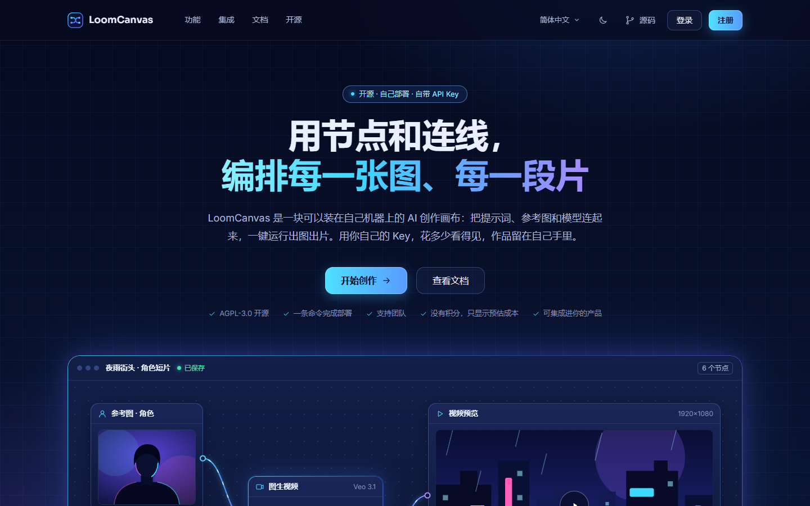
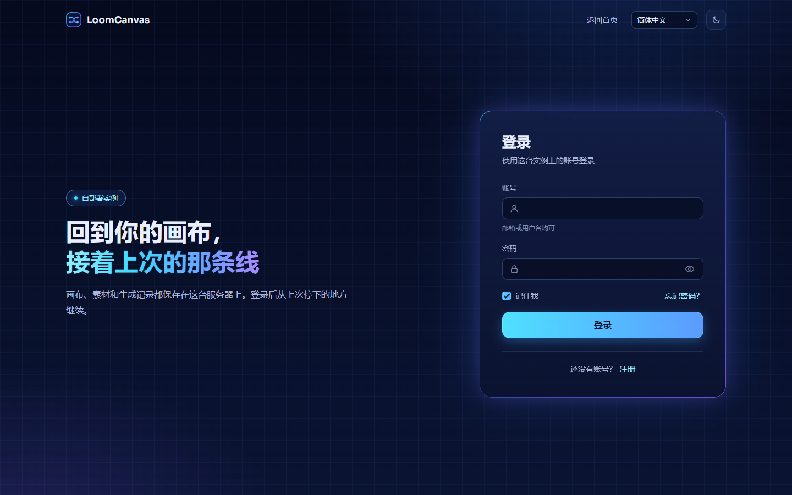
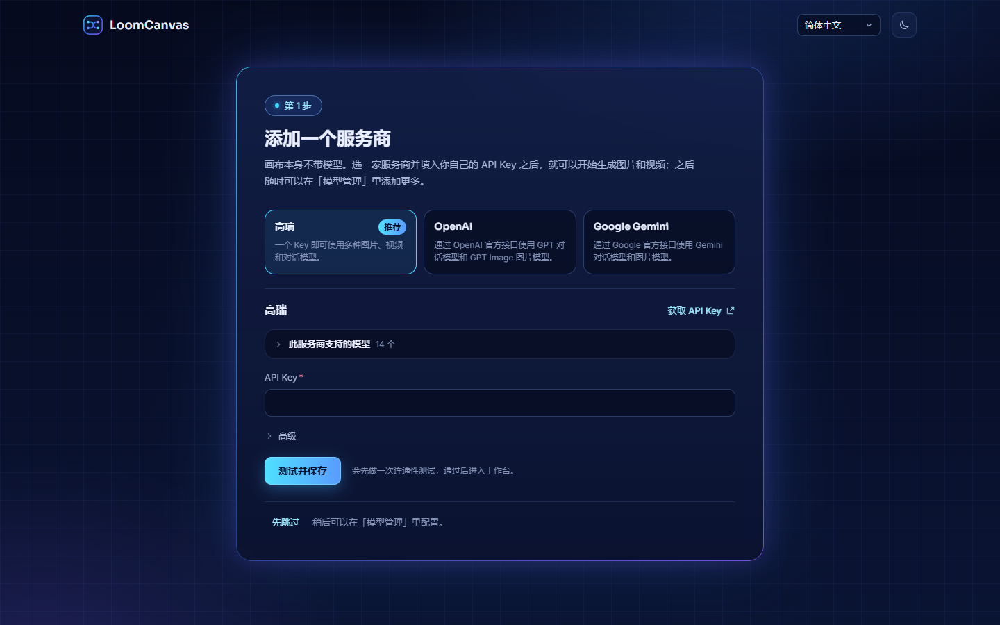
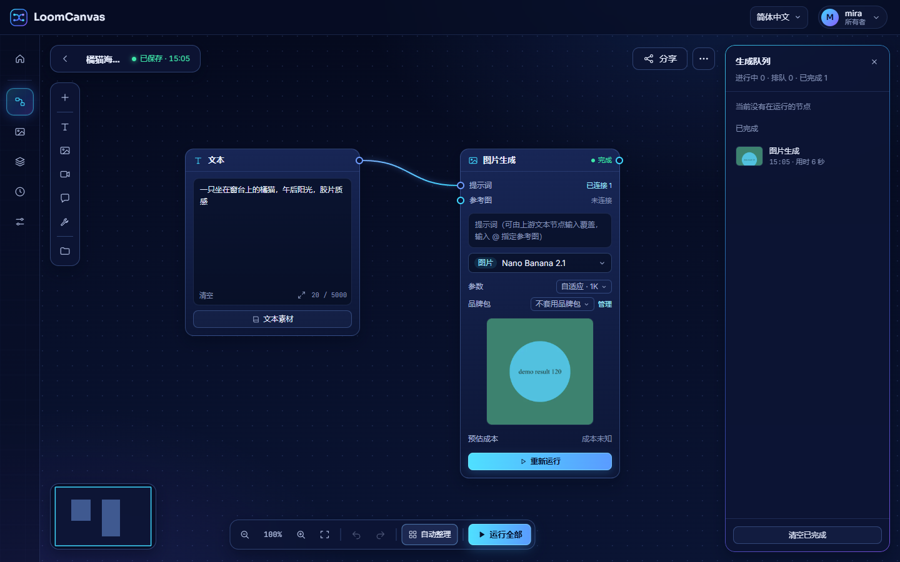
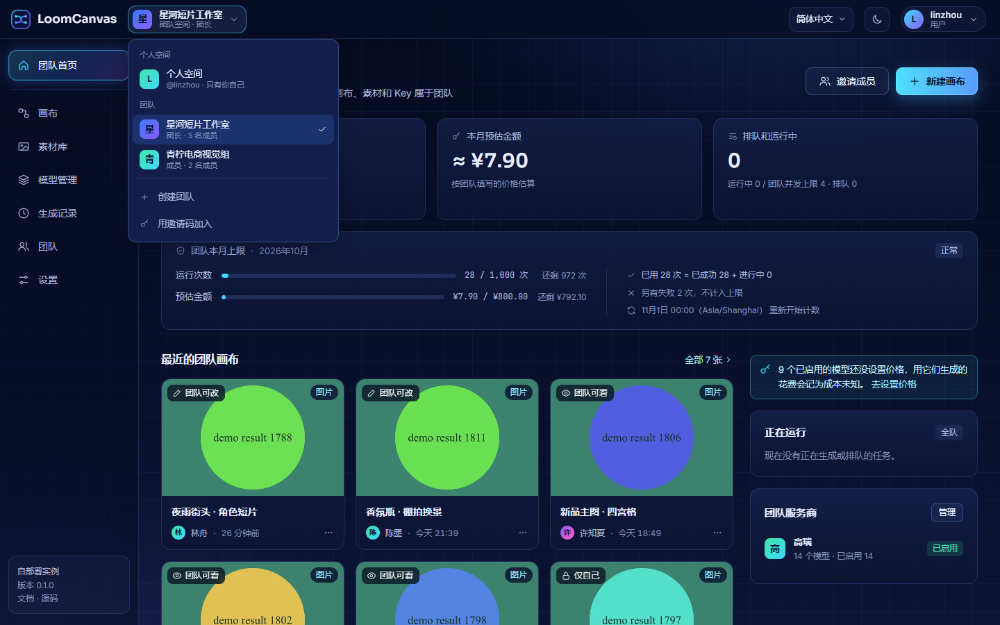
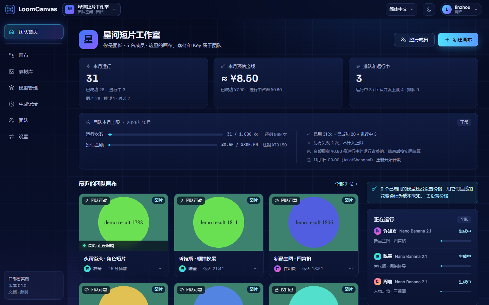

# 快速上手

[English](getting-started.md)

这一页带你从一台空机器走到生成第一张图。

LoomCanvas 本身不带模型。你用自己的 API Key 添加一个服务商，画布替你去调用它的模型。

> 状态：早期开发中。内置的高瑞模型已经对着真实服务运行过；OpenAI 和 Google Gemini 按官方文档接入，项目还没有实际运行过。如果发现请求格式不对，请提 issue。

## 1. 准备

| 需要 | 说明 |
| --- | --- |
| Docker 和 Compose v2（`docker compose`） | Compose 文件会启动 LoomCanvas 和 MongoDB 7。 |
| Git | 拉取源码。镜像在本机构建。 |
| 高瑞、OpenAI 或 Google Gemini 的 API Key | 见第 4 步。 |

不用 Docker 的做法见[部署](deployment.zh-CN.md#不用-docker-运行)。

## 2. 启动

```bash
git clone https://github.com/gaoruitech/genrelay-loomcanvas.git loomcanvas
cd loomcanvas
cp .env.example .env
```

编辑 `.env`：

1. 把 `SECRET_KEY` 设成一串足够长的随机字符（至少 16 位）。可以这样生成：

   ```bash
   openssl rand -base64 32
   ```

2. 本机或内网使用时，`PUBLIC_URL` 留空即可。上传和生成的文件按「当前打开的地址」寻址，换主机、换端口都能用。需要上游模型按地址读取参考素材时（本地存储下用视频做输入、或者给高瑞的图片模型传参考图就需要），再把它设成实例的公网地址（例如 `https://canvas.example.com`）。详见[部署](deployment.zh-CN.md#public_url)。

3. 把 `ADMIN_PASSWORD` 设成超级管理员账号的密码（8 到 128 个字符）。这个账号由服务端在第一次启动时创建，用户名是 `admin`，除非你设了 `ADMIN_USERNAME`。`ADMIN_PASSWORD` 也可以留空：服务端会生成一个随机密码，在启动日志里打印一次，第一次登录时必须换掉。见[账号](#账号)。

然后启动：

```bash
docker compose up -d
```

第一次会构建镜像，需要几分钟。确认已经起来：

```bash
docker compose ps
docker compose logs app
```

日志里出现 `LoomCanvas server listening on :3000` 就是好了。

如果 `ADMIN_PASSWORD` 留空了，生成的密码也在这份日志里，是下面这样的一个框。它只打印这一次：

```text
=======================================================================
| LoomCanvas created the super admin account.                       |
|                                                                     |
|     Username:  admin                                                |
|     Password:  <16 random characters>                               |
|                                                                     |
| This password is shown only this once. Sign in with it: you will be |
| asked to choose your own before anything else.                      |
| Lost it? Run:  node server/src/cli/reset-password.js admin          |
=======================================================================
```

## 3. 打开页面

打开 <http://localhost:3000>。改过 `PORT` 就用改后的端口；从别的机器访问时，把 `localhost` 换成这台机器的地址。

首先看到的是落地页。



页头上有「功能」「集成」「文档」「开源」、语言、主题、「源码」、「登录」和「注册」。窗口不超过 820px 宽时，这些链接、语言和主题收进页头最右边的菜单按钮；手机上「登录」也在这个菜单里，页头只留「注册」（注册关着时是「登录」）。

1. 点「登录」，用超级管理员账号登录：用户名 `admin`（或你设的 `ADMIN_USERNAME`），密码是 `ADMIN_PASSWORD`，或者日志里生成的那个。见[账号](#账号)。
2. 如果用的是生成的密码，先出现的是「设置新密码」这一屏：填入生成的密码，再设一个自己的，然后继续。在这之前别的地方都进不去。
3. 这个账号还没有添加服务商，所以下一页会让你先添加一个（第 4 步）。

其他人点「注册」，注册一个普通账号：起一个用户名，填邮箱和至少 8 位的密码，再输一次密码。系统不会发邮件。注册完就已经登录了，同样会被要求先添加自己的服务商。

以后从「登录」进来，用用户名或邮箱加密码。勾上「记住我」，登录状态保持 30 天，不勾是 12 小时。



## 4. 添加一个服务商



在「添加一个服务商」这一页选一家服务商，填入你的 API Key，点「测试并保存」。系统会先保存，再做一次连通性测试，通过后进入工作台。测试失败时不会保留这个服务商，并显示原因。

表单里列着「此服务商支持的模型」。这份列表是 LoomCanvas 自带的，不是从上游读取的。

| 服务商 | 要填什么 | 说明 |
| --- | --- | --- |
| 高瑞（推荐） | API Key | 一个 Key 可用图片、视频和对话模型。在 <https://gaorui.cc> 获取 Key。 |
| OpenAI | API Key | 走 OpenAI 官方接口。对话，图片生成与编辑。没有视频。 |
| Google Gemini | API Key | 走 Gemini 官方接口。图片生成与编辑、对话。没有视频。 |

每家服务商默认用它的官方地址。要用别的地址，展开「高级」修改「接口地址」；对方必须使用与官方完全相同的接口。

也可以点「先跳过」，稍后在「模型管理」页点「添加服务商」。账号还没有服务商的时候，下次打开应用还会先回到这一页。服务商列表里没有的模型，之后可以作为自定义模型添加。详见[服务商](providers.zh-CN.md)。

## 5. 从模板新建画布

工作台是应用的起始页。其他页面都从左边的侧栏进：「工作台」「画布」「素材库」「模型管理」「生成记录」「设置」。


1. 在工作台的「从模板开始」下面，点「文生图」。（「画布」页的「从模板新建」里是同一份模板。）
2. 新画布以模板的名字命名，直接在编辑器里打开，里面已经有一个文本节点连着一个图片生成节点。


## 6. 运行节点

1. 想换提示词，直接改文本节点里的文字。
2. 点一下图片生成节点。节点旁边会出现一条输入条，里面是提示词、模型、参数和预估成本：打开模型下拉，选一个模型。如果下拉里显示「还没有可用的模型」，打开「模型管理」页检查服务商和模型是否启用。
3. 点输入条里的「运行」，或者节点上的那颗「运行」。

结果框角上的标记显示状态：排队中、运行中、完成、失败。

底部工具条的「运行全部」要求画布上至少有一个成品节点。「文生图」模板里没有成品节点，所以这里用节点自己的「运行」按钮。

## 7. 结果与成本



- 结果显示在节点的结果框里。再次运行不会覆盖它，之前的结果留在节点的历史里。
- 结果文件会转存到你自己的存储里（默认是 `app_data` 数据卷），不依赖上游可能过期的链接。
- 运行按钮旁边显示这次运行的预估成本。新装的实例显示「成本未知」，因为还没有配置价格。在「模型管理」页，点模型那一行的「设置价格」，填上你向上游实际支付的单价，见[服务商](providers.zh-CN.md#价格)。
- 「生成记录」页里有每一次运行的记录，以及所选时间段内的运行次数和预估花费。工作台上显示本月的汇总。

## 账号

使用前必须登录。账号有两种：超级管理员，由服务端创建；普通用户，在页面上注册产生。

**超级管理员是内置的。** 服务端启动时，如果还没有超级管理员账号，就自动创建一个。没有人靠注册成为超级管理员，所以在别人能访问到实例之前，你不需要抢先做什么。超级管理员有且只有一个。它和别人一样在自己的画布上工作，另外负责管理站点：是否开放注册、存储、运行限制、站点名称 / Logo / 默认语言、账号列表，以及谁可以创建团队。这些就是「设置」里只有超级管理员才看得到的分区。

| 变量 | 默认值 | 含义 |
| --- | --- | --- |
| `ADMIN_USERNAME` | `admin` | 超级管理员的用户名。 |
| `ADMIN_PASSWORD` | 空 | 超级管理员的密码，8 到 128 个字符。留空：生成一个 16 位的随机密码，在启动日志里打印一次，第一次登录时必须换掉。 |
| `ADMIN_EMAIL` | 空 | 超级管理员的邮箱。可以不填：超级管理员是唯一可以没有邮箱的账号，这时它用用户名登录，以后可以在「设置 → 账号与安全」里补上。 |

这几个变量只在创建超级管理员时读取。之后每次启动都会忽略它们，所以事后再改 `ADMIN_PASSWORD` 不起任何作用；超级管理员密码丢了，用命令行重置（见下面的**忘记密码**）。用 Docker Compose 时，请在第一次 `docker compose up -d` 之前把 `ADMIN_PASSWORD` 写进 `.env`；没写的话，用 `docker compose logs app` 找到生成的密码。不用 Docker 时，这个框打印在运行 `npm start` 的终端里。更多见[部署](deployment.zh-CN.md#账号)。

**其他人自己注册。** 注册只会产生普通用户。每个账号有自己的**个人空间**：自己的画布、资产、品牌包、运行和用量，以及自己的服务商、API Key、模型和价格。个人空间之间什么都不共用。要几个人一起用同一套画布、素材和 Key，建一个团队，见[团队协作](#团队协作)；只想把一张画布交给别人，发布一条分享链接，对方可以复制一份到自己名下。

| 字段 | 规则 |
| --- | --- |
| 用户名 | 3 到 32 个字符，只能用字母、数字、`_` 和 `-`。不区分大小写地唯一。 |
| 邮箱 | 看起来得是个邮箱地址，并且没被别人用过。不做验证，系统也不会往上面发任何东西。 |
| 密码 | 8 到 128 个字符。 |

登录时用户名和邮箱都可以用。会话有效期 12 小时，选了「记住我」是 30 天。

**关闭注册。** 注册默认是开放的。如果能访问到实例的人里有不该有账号的，超级管理员可以在「设置 → 站点」里把「开放注册」关掉（也可以调用 `PUT /api/admin/site`，见[部署](deployment.zh-CN.md#账号)）。已有的账号照常登录，新的注册不了。想从第一次启动起就关着，在 `.env` 里设 `REGISTRATION_OPEN=false`；这个变量只给这项设置一个初始值，设置一旦保存过就不再理会它。

**超级管理员能做什么，不能做什么。**

- 能：在「设置 → 用户管理」里停用或启用账号、把账号连同它的个人空间删除、重置账号的密码、授权账号创建团队；在「设置 → 站点」里关闭和开放注册；在「设置 → 团队」里处理创建团队的申请、调整团队的上限、停用和恢复团队；以及修改其他站点设置。
- 不能：读取别的账号的画布、文件和 API Key，也进不了自己不是成员的团队。账号列表和团队列表里只有数量（多少张画布、多少次运行、多少成员），不显示内容。

**你自己的账号。** 「设置 → 账号与安全」（顶栏上点自己的名字，菜单里也有）可以改用户名、邮箱和密码，也能看到自己的登录会话并把其中任何一个下线。改密码之后，这个账号在其他设备上都会被退出登录。

**忘记密码。** 没有「找回密码」邮件。别人的密码由超级管理员在「设置 → 用户管理」里重置，超级管理员会拿到一个临时密码转交给对方；超级管理员自己的密码，由运行服务端的人用命令行重置：`node server/src/cli/reset-password.js <用户名或邮箱>`。不管哪一种，用临时密码登录之后，系统都会要求先设置新密码，之后才能继续使用。见[部署](deployment.zh-CN.md#忘记密码)。

**从更早的版本升级过来？** `ACCESS_PASSWORD` 已经不再使用，请从 `.env` 里删掉。新版本第一次启动时，服务端会创建超级管理员，并把已有的全部数据交给它：先设好 `ADMIN_PASSWORD`（或者从日志里读出生成的密码），用超级管理员账号登录，数据都在。启动新版本之前，请先看[部署](deployment.zh-CN.md#从没有账号的版本升级)。

账号能保护什么、不能保护什么，见[安全](security.zh-CN.md#账号)。

## 团队协作

团队是几个账号共用的一个空间：画布、素材、服务商和 Key、生成记录放在一起，按角色（团长、管理员、成员）分工。同一张画布同一时间一个人编辑，不是实时协作。没有任何账号被授权创建团队时，实例和没有团队功能时一样。



从零到一个能用的团队，四步：

1. **授权。** 创建团队要超级管理员授权。超级管理员自己始终可以创建；给别人授权，在「设置 → 用户管理」那一行的「更多」里点「允许创建团队」，或者在「设置 → 团队」的「创建团队的申请」里批准对方提交的申请（对方在空间切换器里点「申请创建团队」）。
2. **创建。** 有授权的账号点顶栏 Logo 右边的空间切换器，选「创建团队」，填一个名称。创建者就是团长，页面随即切到团队空间。
3. **配置服务商。** 团队空间只用团队自己的服务商，个人空间里的 Key 带不过来。新团队还没有服务商，所以先出现的是和第 4 步一样的「添加一个服务商」页：填入团队要用的 Key。也可以先跳过，之后在团队的「模型管理」里配置（团队首页的三步引导里有入口）。成员可以直接使用这些模型，但看不到 Key。
4. **邀请成员。** 在「团队 → 成员」的「邀请链接」里点「生成新链接」，把链接发给同事。对方登录后打开链接、确认，就以成员身份加入。系统不发邮件。



**超级管理员的第一步。** 团队相关的站点设置在「设置 → 团队 → 团队功能」：每人最多创建几个团队（默认 3）、每个团队最多多少人（默认 50）、团队动态保留天数（默认 365）；一个团队最多同时跑几个任务在「设置 → 运行限制」里（「团队并发上限的默认值」，默认 4）。见[配置](configuration.zh-CN.md#团队)。超级管理员管的是团队的存在和规模，看不到团队里的内容。

角色、可见范围、轮流编辑、每月上限、退出和解散，见[使用指南的「团队」一章](user-guide.zh-CN.md#团队)。

## 接下来

- [使用指南](user-guide.zh-CN.md)：画布能做的所有事。
- [部署](deployment.zh-CN.md)：把实例放到公网之前先看。
- [常见问题](faq.zh-CN.md)：遇到问题时看。
