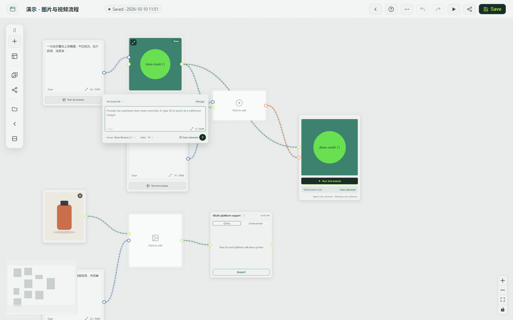

# User guide

[简体中文](user-guide.zh-CN.md)

How to use the app, and above all the canvas. A guide to the canvas is also built into the app: in the editor, open **More ⋯** on the toolbar and choose **Guide**.

The canvas is a workspace you can pan and extend without limit. You place source material and model steps as blocks (nodes) and wire them together into a small production pipeline: sources on the left, model steps in the middle, finished work on the right.

## Before you start

Generation nodes need a model. Add a provider on the **Models** page first; see [Getting started](getting-started.md). Without one, generation nodes show "No models available yet", and the editor shows a notice with a link to the Models page.

## Finding your way around

After signing in, every page has the same frame: a top bar with the site name, the language dropdown and your account menu (**Account & security**, **Docs**, **Sign out**), and a sidebar on the left.

| Sidebar entry | What is there |
| --- | --- |
| **Workbench** | The start page: your recent canvases, the canvas templates, recent generations, this month's usage, the queue and your providers. |
| **Canvases** | All your canvases: create, rename, duplicate, download, delete. Opening one takes you to the editor. |
| **Assets** | Your uploaded and saved images and videos, and, on a second tab, your [brand kits](#brand-kits). |
| **Models** | Providers, their models and the prices you enter. See [Providers](providers.md). |
| **History** | Every run, with totals, filters and CSV export. See [History](#history). |
| **Settings** | Interface language, your account and your sign-in sessions. The super admin also sees Storage, Run limits, the site's name, logo and default language, Site (registration) and Users. See [Configuration](configuration.md#admin-settings). |

On the workbench, **New canvas** asks for a name and creates an empty canvas, a card under **Start from a template** creates one from that template, and **Usage** shows this month's runs, success rate and estimated cost with a bar per day for the last 14 days. "Today" and "this month" follow the time zone of your browser.

In the editor the sidebar shrinks to icons, to leave the width to the canvas.

## The editor

| Area | What is there |
| --- | --- |
| Top left | Back to your canvases, the canvas name (click it to rename), the save status (click it to save at once) and the [brand kit](#brand-kits) this canvas uses. |
| Toolbar | Vertical on the left by default. **+** lists every node. The buttons below it are one per category: text, image, video, chat / analysis, output and tools. The folder button opens the asset library, the canvas templates and your share links. The last two are **Share** and **More ⋯**. The toolbar can be moved: drag it by the handle at its start (or by its empty background) to anywhere on the canvas; it snaps when it gets close to an edge or to its default spot. The switch next to the handle flips it between horizontal and vertical. If you drop it on the title block, the bottom toolbar, the minimap or the queue button, it moves aside. Double-click the handle, or click it and choose **Reset**, to send it back to the left. Position and orientation are remembered in the browser. On a phone it is a fixed row under the title block and cannot be moved. |
| Bottom toolbar | Zoom out / in, reset to 100%, fit to screen, undo / redo, **Tidy up**, **Run all**. |
| Bottom left | Minimap. Drag or scroll it to jump around. |
| Queue button | A round floating button, in the bottom-right corner by default. While something runs it shows a progress ring and the number of unfinished nodes; a badge counts what has finished since you last looked, in red when something failed or could not start. Click it for the list: the nodes of this canvas that are running, queued or finished since you opened it. Click a row to jump to its node. Drag the button anywhere on the canvas (it snaps to the left or right edge, keeps clear of the toolbar, and the browser remembers the spot); double-click it, or use **Reset** in the list, to send it back. On a phone it sits above the bottom toolbar. |
| Right-click on empty canvas | Add nodes and canvas actions. **More ⋯** opens the same canvas actions. |
| Right-click on a node | Actions for that node. |

Basics:

- **Pan** by dragging the empty canvas with the left mouse button. **Zoom** with the mouse wheel.
- **Box-select** by holding Shift and dragging. Alignment guides appear while you move a node.
- **Drop files**: drag images or videos from your computer onto the canvas, several at once if you like. A node is created at the pointer and the file is uploaded.
- **Paste an image** with Ctrl+V. Pasting text into an input works as usual.

## Node types

Add a node by right-clicking the empty canvas or with the **+** button on the toolbar.

### Sources (free)

| Node | What it does |
| --- | --- |
| Text | A piece of prompt text. You can insert a ready-made snippet from the text templates. |
| Image | Upload from your computer, or pick from My assets or Stock assets. Once it has an image you can crop and rotate it. |
| Video | Upload from your computer, or pick from My assets or Stock assets. |
| Image set | Bundles several images and hands them downstream together: upload, multi-select, or wire in images from upstream. |

### Generation (calls a paid model)

| Node | What it does |
| --- | --- |
| Image generation | Creates images from a prompt, with or without reference images. The prompt can come from an upstream Text node. Typing `@` in the prompt lets you point at a specific reference image. |
| Image edit | One image plus an instruction gives an edited image, for example "replace the background with a beach". |
| Video generation | Text-to-video or image-to-video. Where the model supports it, choose "First & last frame" or "Reference images". |
| Video edit | A source video plus an instruction gives an edited video. |
| Video analysis | Sends a video to a chat model and outputs text you can pass downstream. Only chat models that accept video input are listed. |
| Language model | Writes text from a prompt: analysis, copy, plans. |

These six nodes come in three layouts. Choose one under **Settings → Appearance → Node layout**, or switch from **More ⋯** on a canvas; the choice is kept with your account, so it follows you to any device:

| Layout | What a node looks like | Where you edit prompt, model and parameters |
| --- | --- | --- |
| Result first (default) | The node is the result: header, picture, and one line of "model · parameters · cost". Before the first run it is a dashed placeholder with the first line of the prompt and a **Run** chip. | Select one node and a composer appears under it: the prompt (type `@` to point at a reference image), model, parameters, estimated cost and Run. Just start typing to write the prompt, Ctrl / ⌘ + Enter runs, Esc collapses it. Hovering the result of an unselected node also offers **Re-run**. |
| Compact + side panel | Header, thumbnail, a one-line summary and a small Run button, so the most nodes fit on screen. | Select one node and the inspector at the right edge of the canvas shows all of its settings and its versions. With nothing or several nodes selected the inspector is closed. |
| Everything on the node | Result on top, one prompt field that grows as you type, and model, parameters, cost and Run in a single row. | On the node itself. |

All three do the same things and send the same request to the model; only where things sit differs. Aspect ratio, resolution, duration and count are in the parameters, which show only what the selected model supports. When the prompt comes from a connected text node, that text is shown read-only and the node's own text becomes the **fallback**: the connected text is used whenever it has content, and the node's own only when it is empty.

Switching layouts changes the size of the nodes but never moves what you arranged. If nodes overlap afterwards (or when you open a canvas that was arranged under another layout), a one-line notice at the bottom offers **Auto-arrange**; nothing moves until you click it, and it can be undone. On a phone the composer and the inspector are bottom sheets. A canvas opened from a share link is always shown in the result-first layout, read-only.

Which models a node offers, and what each can do, depends on the providers you added and on the custom models you added to them; see [Providers](providers.md).

### Output

| Node | What it does |
| --- | --- |
| Output | Collects everything connected to it into one grid; click a tile to see it full size. Its "Run this branch" button runs the whole chain upstream of it. It also adds up the cost of everything upstream. |

### Tools (processed on your server, free)

| Node | What it does |
| --- | --- |
| Multi-platform export | Turns one hero image into the sizes each platform needs. Two sets: domestic (Taobao main image 1:1, white background 1:1, Xiaohongshu 3:4, Douyin 9:16) and cross-border (white background 1:1, Amazon 1:1, Shopify 4:5, TikTok 9:16). Download everything at once. |
| Slice | Cuts one image into tiles: a preset, or your own columns × rows (up to 6 × 6). |
| Collage | Combines several images into one: presets up to 4 × 4, cell ratio, spacing, background colour. |
| Watermark | Upload a logo in the node, then set its position, size, opacity and margin. A transparent PNG looks best. |
| Resize | Changes the aspect ratio by padding, never cropping; sets format and quality; can cap the file size. |

Tool nodes never call a model, so they cost nothing.

### Groups

A group is a frame around several nodes that moves as one.

- Hold Shift and box-select the nodes, then right-click one and choose to group them, or press Ctrl+G.
- Right-click a group to merge groups, ungroup (the nodes stay), move nodes out, or delete the group with its nodes.

## Wiring

- Every node has small dots on its sides: **right is output, left is input**. Drag from a dot on the right to a dot on the left of another node.
- Ports are typed: image to image, text to text, video to video. Mismatched types will not connect.
- A port that accepts several inputs takes several wires. On a single-input port, a new wire replaces the old one.
- A Video generation node in first-and-last-frame mode has a second image input for the last frame.

If a wire will not connect, the types probably do not match, or the direction is reversed.

## Running

| How | Where | What runs |
| --- | --- | --- |
| One node | The node's **Run** button | That node, plus any upstream nodes that need updating. On a node that already has a result, it runs again, after a confirmation. |
| A branch | **Run this branch** on an Output node | The whole chain upstream of that Output node. |
| Everything | **Run all** in the bottom toolbar | The whole canvas in wiring order. Runs queue automatically, and downstream nodes are skipped when an upstream one fails. The canvas needs at least one Output node. |
| Batch | **More ⋯ → Batch run** | Pick an Image node as the variable, supply up to 100 source files, and the chain below it is re-run once per file. Keep the page open while it runs. |

Status badge on the result frame:

| Badge | Meaning |
| --- | --- |
| Queued | Waiting for a free slot. How many run at once, for the whole instance and for one account, is set by the super admin under **Settings → Run limits**. |
| Running | Submitted to the upstream; progress is shown when the upstream reports it. |
| Done | The result is stored on your server. |
| Failed | Open the task details (right-click the node) for the reason. |
| Inputs changed | Something upstream changed since this result was made. Run again to update it. |

**Running again.** Every run submits a new task to the provider and is billed again. So before generation nodes that already have a result are re-run, the canvas asks "Run again?" once for the whole batch of nodes. Tick **Don't ask again this session** to skip the question for the rest of the browser session. A first run is never asked about, and neither is a batch run.

**Canceling.** A node that is running shows a **Cancel run** button. The node then shows **Canceled**.

**Reloading.** If you reload the page while something is running, the canvas keeps waiting for the result. It does not submit the job twice. This also holds for Language model and Video analysis nodes.

A run that takes longer than its timeout is marked failed: 10 minutes for images, 30 for videos and 5 for Language model and Video analysis nodes by default. These limits, and the timeouts for submitting a task and for downloading a result, are set by the super admin under **Settings → Run limits**.

## Results and history

- A re-run never overwrites earlier images or videos. They stay in the node's history; click a thumbnail to switch back. Language model and Video analysis nodes have no history: the new text replaces the text in the node.
- Hover a result and click the zoom button to see it full size with the details of that run.
- Right-click a node for: view or download the original, **Save to my assets**, edit image (crop / rotate), task details, **Continue from this version** and **Fork into a new node**.
- Results are files in your own storage. By default they are kept forever; if the operator set a retention period, the files of old runs are removed and their images stop loading.

### Cost

- Next to the Run button, a generation node shows the estimated cost of one run with the current parameters, for example "≈ ¥0.12".
- **Cost unknown** means the model has no price configured. You can still run it.
- After a run, its cost is kept in the node's run details and history. Language model and Video analysis nodes show it at the bottom of the node.
- An Output node totals its upstream chain: recorded cost for nodes that have run, the estimate for those that have not.
- A solid button calls a paid model. An outline button runs locally and is free.

These amounts are calculated from the prices you entered on the **Models** page. They are for reference; the real bill comes from your upstream provider.

### History

The **History** page lists every run of your account: a preview, the prompt and the canvas it belongs to, the model, type, status, duration, time and cost.

- The four tiles at the top total the selected period: runs, succeeded, failed and estimated cost. Cost counts succeeded runs only.
- Pick a period with the two dates or with **Last 7 days**, **Last 30 days** or **This month**, and narrow it by type, status and model. The search box filters the page that is shown.
- The actions of a row are **View details**, **Open on canvas**, **Download result**, **Copy prompt** and, while it is still running, **Cancel run**.
- **Export CSV** downloads the records that match the current filters.
- **Clean up** deletes the finished records (succeeded, failed, canceled) created before the day you pick, after a confirmation. Queued and running records, canvases and generated files are kept. It cannot be undone, and the run counts and cost totals for that period go with the records.

Days are the calendar days of your browser's time zone: "today" is your local day, on this page, in the clean-up dialog and on the workbench.

## Brand kits

A brand kit is a fixed set of generation settings: up to 5 reference images, a piece of text that always goes in front of the prompt (the prompt prefix), and a list of things to leave out. You choose one **per canvas**, and every Image generation, Image edit, Video generation and Video edit node on that canvas adds it on each run. Other nodes (language model, video analysis, tools) ignore it.

**What a run adds**

- The prompt prefix goes in front of the node's prompt, on a line of its own.
- The list of things to leave out is added at the end of the prompt as "Do not include: …". This is a sentence in the prompt, not an API parameter, so a model may ignore it.
- The kit's reference images are sent after the node's own. Images wired into the node always come first and are never pushed out; the kit's images only fill the slots the model has left.

**What it does not do**

- It does not change the model, aspect ratio, resolution, duration or count, and the estimated cost stays the same.
- A video node in first/last-frame mode gets the text only, because that mode sends exactly the two frames. A model that takes no reference images also gets the text only.
- A kit has no logo or colour fields. Put a logo in the reference images, and colours or style in the prompt prefix.
- A kit is looked up when a node runs. Edit a kit and every later run uses the new content; results you already have do not change.

**Choosing a kit for a canvas**

The brand kit button sits at the top left of the canvas, next to the canvas name and the save status. It shows the kit this canvas uses, or "No brand kit". Click it for a short explanation, the list of your kits (each with its reference images and a summary of what it holds) and **None**. The choice applies to the whole canvas and is saved with it. **Manage brand kits** goes to Assets › Brand kits; **New brand kit** and the pencil next to a kit open the editor in a dialog, so you stay on the canvas.

**Seeing what will be sent**

Select a generation node. Where you edit its prompt (the composer, the inspector, or the node itself) a line says "Brand kit applied: <name>". Click it to see exactly what the next run adds: the text in front of the prompt, the line at the end, and the reference images that will be sent, together with any that will not be sent and why (the model's limit, first/last-frame mode, or a model without reference images). After a run, the task details show the prompt that was actually sent.

**An exception for one node**

Right-click a generation node, or use "This node" at the right of that line, and choose **Follow canvas** (the default), **No kit for this node**, or another kit for this node only. A node with an exception shows a small icon next to its title; hover it to see which exception it is. Nothing is added to the node's body.

**Managing kits**

Assets › Brand kits (`/assets/brand-kits`) lists your kits as cards with their reference images, a summary, the prefix and the "do not include" list, and in how many canvases each is in use. From there you create, edit, duplicate and delete kits and choose the **default for new canvases**: canvases you create afterwards start with that kit, and existing canvases are not affected. You can keep up to 50 kits.

Deleting a kit does not change your canvases: canvases and nodes that used it simply run without a kit from then on, and the results you already have stay.

**Copies, share links and templates**

- Duplicating one of your canvases keeps its kit and the exceptions on its nodes.
- A share link carries no brand kit. Viewers see the prompt that was actually sent (in the task details), not the kit; a copy made from a share link starts without a kit.
- Templates carry no kit: nodes added from a template follow the canvas they are added to.
- Loading another of your canvases into the current one keeps what each loaded node used: if the two canvases have different kits, the loaded nodes get an exception.

**Canvases from an earlier version**

Earlier versions chose the kit on every node. Such canvases are converted automatically: when every generation node used the same kit it becomes the canvas's kit; otherwise the canvas has no kit and each node that had one keeps it as an exception. Either way each node runs with the kit it ran with before.

## Templates

- **Canvas templates** drop a whole pipeline onto the canvas in one click. Open them from the folder button of the toolbar, or start a new canvas from one: a card under **Start from a template** on the workbench, or **New from template** on the Canvases page. Two are built in: *Text to image* and *Image to video*.

  

- **Text templates** are ready-made prompt snippets, in Chinese and English, that you insert into a Text node.

## Asset library

In the editor, click the folder button of the toolbar and choose **Asset library**. The dialog has these tabs:

| Tab | Contents |
| --- | --- |
| My assets | Images and videos you uploaded or saved, in four categories: product shots, brand assets, references, outputs. |
| Canvas templates | See above. |
| Text templates | See above. |
| My share links | Every share link you created. |
| Stock assets | Shown first, and only when the person running the instance has preloaded shared assets. Empty on a new install. |

To keep a result for reuse, right-click a generation node and choose **Save to my assets**. It appears under My assets → Outputs.

Deleting an asset removes it from the library only. Nodes that already use it keep working.

The **Assets** page in the sidebar shows the same My assets outside the editor. There you upload by dragging files in, filter by category, type and folder, search by name, and select assets to download, move to a folder, rename, copy a link or delete.

## Share links

A share link gives read-only access to a snapshot of one canvas.

1. Click **Share** on the editor toolbar.
2. Enter a title and optionally a description.
3. Choose when it expires: 1 day, 7 days, 30 days or never.
4. Copy the link.

What to know:

- **It is a snapshot.** Editing or deleting the original canvas later does not change what you shared. Creating a link for the same canvas again updates the snapshot and keeps the same link.
- **Anyone with the link can open it**, without signing in. The images and videos on it are public files too. Do not share canvases that contain things you want to keep private.
- **Expiry**: after the date, the link stops working on its own.
- **Revoke**: in the asset library under My share links, click **Revoke**. The link stops working immediately. If you share that canvas again later, it gets a new link; the old one never comes back.
- A visitor who has an account on the instance can click **Copy to my canvases** to get an editable copy.

## Canvases

On the **Canvases** page (its heading is "My canvases") you can create, rename, duplicate and delete canvases, and download all images and videos of a canvas as a zip. The workbench shows the most recent ones.

Inside a canvas:

- **Autosave** runs about 1.5 seconds after a change. Ctrl+S saves at once.
- **Batch download** (More ⋯) packs the canvas results into one archive, up to 100 files at a time. Save the canvas first.
- **Load another canvas** (More ⋯) copies all nodes and connections of another canvas into this one.
- **Tidy** (More ⋯ or right-click): "Arrange by data flow" lines nodes up along their wires; "Snap to grid" aligns them to the grid. Both can be undone. **Tidy up** in the bottom toolbar is the same "Arrange by data flow". With 2 or more nodes selected you can align them; with 3 or more, distribute them evenly.
- **Find nodes** with Ctrl+F: search prompts, text, models or node types.
- **Immersive mode** (top of the More ⋯ menu) hides the top bar and the sidebar so the canvas fills the screen.

A canvas can hold up to 500 nodes and 2000 connections.

**Canvases from an earlier version.** Generation nodes are much taller than they used to be. The two built-in templates were re-spaced for the new sizes. A canvas that was last saved by a version from before the redesign is arranged once, the first time you open it in the editor, and only if its nodes actually overlap at the new sizes. It uses the same arrangement as **Tidy up**, a notice tells you it happened, and Ctrl+Z puts the nodes back where they were. It never happens again for that canvas, and a canvas saved by the current version is never touched.

## Shortcuts

On macOS use ⌘ instead of Ctrl.

| Keys | Action |
| --- | --- |
| Ctrl+Z | Undo |
| Ctrl+Shift+Z, Ctrl+Y | Redo |
| Ctrl+A | Select all |
| Ctrl+C, Ctrl+V | Copy and paste nodes, with the connections between them |
| Ctrl+D | Duplicate the selection in place |
| Delete, Backspace | Delete the selection |
| Ctrl+S | Save |
| Ctrl+0 | Fit the view |
| Ctrl+F | Find nodes |
| Ctrl+G | Group |
| Ctrl+Shift+G | Ungroup / move out of group |
| Shift + drag | Box-select |
| Esc | Close menus |

## Language and appearance

- **Language**: the dropdown in the top bar, or **Interface language** under **Settings → Appearance**, switches between 简体中文 and English. Messages from the server follow the same language. The choice is remembered per browser; until you choose, the **Default language** the super admin set under **Settings → Appearance** applies.
- **Node layout**: one of three under **Settings → Appearance**; it decides how generation nodes look on the canvas, see [Generation](#generation-calls-a-paid-model). It is stored with your account, not in the browser.
- **Theme**: the interface has one dark theme. There is no light theme and nothing to switch.
- **Canvas appearance** (More ⋯ or right-click): background colour, pattern and density of one canvas. It is saved with the canvas and travels with its share links.

## Limits worth knowing

| Limit | Value |
| --- | --- |
| Upload from the canvas, per file | The server's `MAX_UPLOAD_MB` (50 MB by default). The canvas reads the limit from the server and refuses a larger file before uploading it. |
| File types | Images and videos, recognised by content, not by file name |
| Reference images per run | Up to the selected model's limit; extra ones are left out with a notice |

More answers in the [FAQ](faq.md).
