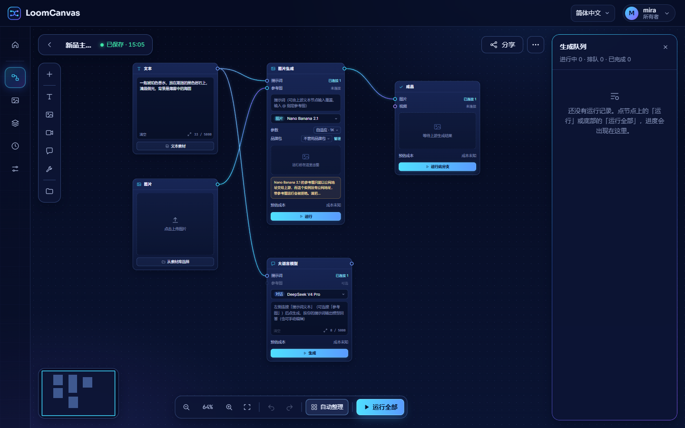
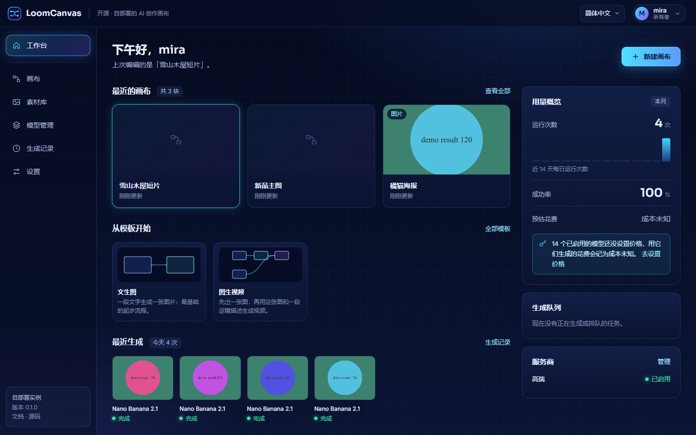
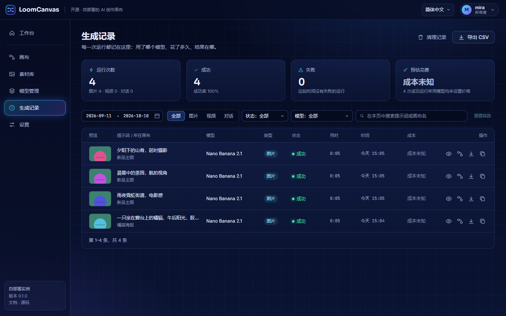
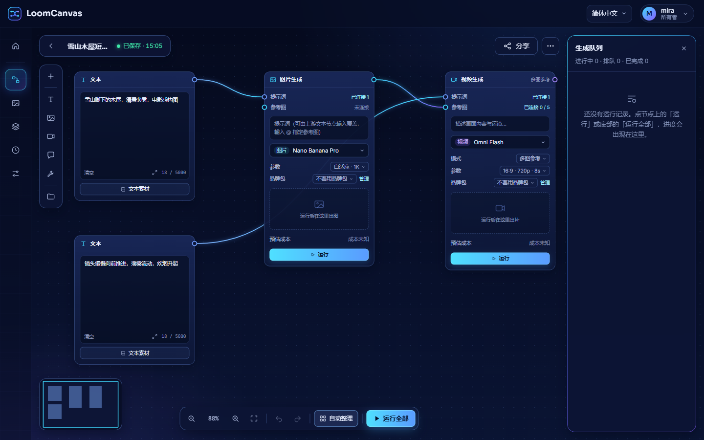

# 使用指南

[English](user-guide.md)

这一页讲应用怎么用，重点是画布。应用里也内置了一份画布教程：在编辑器里点右上角的「更多 ⋯」，选「使用教程」。

无限画布是一块可以自由拖动、无限延展的工作台。把素材和模型能力摆成一个个方块（节点），用线连起来，就是一条小的生产流水线：左边放素材，中间接模型处理，右边出成品。

## 开始之前

生成节点需要模型。请先在「模型管理」页添加一个服务商，见[快速上手](getting-started.zh-CN.md)。没有服务商时，生成节点会提示「还没有可用的模型」，编辑器里也会出现一条提示，带着去「模型管理」页的链接。

## 整体导航

登录之后，每个页面的外框都一样：顶栏上是站点名称、语言下拉和账号菜单（「账号与安全」「文档」「退出登录」），左边是侧栏。

| 侧栏入口 | 有什么 |
| --- | --- |
| **工作台** | 起始页：最近的画布、画布模板、最近生成、本月用量、生成队列和你的服务商。 |
| **画布** | 你的全部画布：新建、重命名、复制、下载、删除。点开一张就进入编辑器。 |
| **素材库** | 你上传和存下来的图片、视频。 |
| **模型管理** | 服务商、它们的模型，以及你填的价格。见[服务商](providers.zh-CN.md)。 |
| **生成记录** | 每一次运行，带汇总、筛选和 CSV 导出。见[生成记录](#生成记录)。 |
| **设置** | 界面语言、你的账号和登录会话。所有者还能看到「存储」「运行限制」、站点名称 / Logo / 默认语言、「站点」（是否开放注册）和「用户管理」。见[配置](configuration.zh-CN.md#管理设置)。 |

在工作台上，「新建画布」让你起个名字，然后建一张空白画布，「从模板开始」下面的卡片用那个模板新建一张，「用量概览」显示本月的运行次数、成功率和预估花费，以及近 14 天每天一根柱子。「今天」「本月」按你浏览器所在的时区算。

进了编辑器，侧栏会收成一排图标，把宽度让给画布。

## 编辑器

| 位置 | 有什么 |
| --- | --- |
| 左上角 | 返回我的画布、画布名（点一下就能改）和保存状态。点保存状态可以立即保存。 |
| 右上角 | 生成队列按钮、「分享」和「更多 ⋯」。 |
| 左侧节点面板 | 「+」列出全部节点。下面的按钮每个是一类：文本、图片、视频、对话 / 分析、输出与工具。最下面一个按钮里是素材库、画布模板、品牌包和我的分享。 |
| 底部工具条 | 缩小 / 放大、恢复到 100%、适应屏幕、撤销 / 重做、「自动整理」「运行全部」。 |
| 左下角 | 小地图。可拖可缩放，用来快速定位。 |
| 右侧 | 生成队列：这张画布上正在运行、排队中和已完成的节点。点一行可以定位到那个节点。收起它可以把宽度还给画布。 |
| 空白处右键 | 添加节点和画布操作。「更多 ⋯」里是同一份画布操作。 |
| 节点上右键 | 针对该节点的操作。 |

基础操作：

- **平移**：空白处按住左键拖动。**缩放**：鼠标滚轮。
- **框选**：按住 Shift 拖出方框。移动节点时会出现对齐参考线。
- **拖文件进画布**：把本地的图片、视频直接拖进来，可以一次拖多个。会在鼠标位置建节点并上传。
- **粘贴图片**：按 Ctrl+V。在输入框里粘贴文字不受影响。

## 节点类型

添加节点：空白处右键，或点左侧节点面板上的「+」。

### 素材（免费）

| 节点 | 作用 |
| --- | --- |
| 文本 | 一段提示词文字。可以从文本模板里选一段现成的填入。 |
| 图片 | 本地上传，或从「我的资产」「素材库」里选。有图后可以裁剪、旋转。 |
| 视频 | 本地上传，或从「我的资产」「素材库」里选。 |
| 图片集合 | 把多张图汇成一组，一次性交给下游：可以上传、多选，也能接上游的图。 |

### 生成（调用付费模型）

| 节点 | 作用 |
| --- | --- |
| 图片生成 | 按提示词出图，可以带参考图，也可以不带。提示词可以由上游的文本节点提供。在提示词里输入 `@` 可以指定用哪张参考图。 |
| 图片编辑 | 一张图加一条编辑指令，得到改后的图，例如「把背景换成海边」。 |
| 视频生成 | 文生视频或图生视频。模型支持时可以选「首尾帧」或「多图参考」。 |
| 视频编辑 | 一段源视频加一条指令，得到改后的视频。 |
| 视频分析 | 把视频交给对话模型，输出文字，可以继续交给下游。只列出能输入视频的对话模型。 |
| 大语言模型 | 按提示词写一段文字：分析、文案、方案。 |

图片、视频的生成和编辑节点结构一致：成品框、参考图条、提示词框、模型下拉、参数下拉、品牌包行和运行按钮。比例、分辨率、时长、数量都在参数下拉里，只显示所选模型支持的项。

节点里能选哪些模型、每个模型能做什么，取决于你添加的服务商，以及你给它们添加的自定义模型，见[服务商](providers.zh-CN.md)。

### 输出

| 节点 | 作用 |
| --- | --- |
| 成品 | 把连进来的产物汇总成一个九宫格，点开看大图。它的「运行此分支」按钮会跑它上游的整条链。它还会汇总上游整条链路的成本。 |

### 工具（在你的服务器上处理，免费）

| 节点 | 作用 |
| --- | --- |
| 多平台导出 | 一张主图导出各平台需要的尺寸。分两组：国内（淘宝主图 1:1、白底主图 1:1、小红书 3:4、抖音 9:16）和跨境（白底主图 1:1、Amazon 1:1、Shopify 4:5、TikTok 9:16）。支持全部下载。 |
| 切片 | 把一张图切成多块：用预设，或自己定列 × 行（最多 6 × 6）。 |
| 拼图 | 把多张图拼成一张：预设最大 4 × 4，可设每格比例、间距、底色。 |
| 加水印 | 在节点里上传 logo，然后设位置、大小、透明度和边距。透明底 PNG 效果最好。 |
| 改尺寸 | 改比例（补白，不裁切）、格式、画质，也可以限制文件体积。 |

工具节点不调用任何模型，所以没有成本。

### 分组

分组是套在几个节点外面的一个框，整组一起拖动。

- 按住 Shift 框选节点，在节点上右键选择成组，或按 Ctrl+G。
- 在组上右键：合并为一组、解散（保留节点）、把节点移出组、连节点一起删除。

## 连线

- 每个节点两侧有小圆点：**右侧是输出，左侧是输入**。从右侧圆点拖到另一个节点左侧的圆点就连上了。
- 接口分类型：图片接图片、文本接文本、视频接视频。类型不匹配连不上。
- 能接多份输入的接口可以连多条线。只收一份输入的接口，再连一条会替换旧的。
- 视频生成节点在首尾帧模式下会多出一个图片输入口，用来接尾帧。

连不上，多半是类型不匹配，或者方向反了。

## 运行

| 方式 | 入口 | 跑什么 |
| --- | --- | --- |
| 单个节点 | 节点上的「运行」 | 这个节点，以及它需要更新的上游。已经有结果的节点再点一次就是重跑，会先问一句。 |
| 一条分支 | 成品节点上的「运行此分支」 | 这个成品节点上游的整条链。 |
| 全部 | 底部工具条的「运行全部」 | 整张画布，按连线先后执行。自动排队，上游失败时下游不跑。画布里至少要有一个成品节点。 |
| 批量 | 「更多 ⋯ → 批量运行」 | 选一个图片节点当变量位，提供最多 100 份素材，下游整条链每份素材跑一遍。运行期间页面要一直开着。 |

成品框上的状态标：

| 状态 | 含义 |
| --- | --- |
| 排队中 | 在等空位。整个实例、单个账号同时能跑几个，由所有者在「设置 → 运行限制」里设置。 |
| 运行中 | 已提交给上游。上游报告进度时会显示进度。 |
| 完成 | 结果已经存到你的服务器上。 |
| 失败 | 在节点上右键打开任务详情看原因。 |
| 输入已更新 | 这个结果生成之后，上游有东西变了。重新运行才会更新。 |

**重新运行。** 每运行一次都会向上游新提交一个任务，并再计一次费。所以在重跑已经有结果的生成节点之前，画布会先问一次「重新运行？」，一批节点合起来只问一次。勾选「本次会话不再询问」，这次浏览器会话里就不再问。第一次运行不会问，批量运行也不会问。

**取消。** 运行中的节点上有「取消运行」按钮，取消后节点显示「已取消」。

**刷新页面。** 运行途中刷新页面，画布会接着等结果，不会重复提交。大语言模型节点和视频分析节点也一样。

运行时间超过超时会被判失败：默认图片 10 分钟，视频 30 分钟，大语言模型和视频分析节点 5 分钟。这几个上限，以及提交任务和下载结果的超时，由所有者在「设置 → 运行限制」里设置。

## 结果与历史

- 重跑不会覆盖旧的图片和视频。旧结果留在节点的历史版本里，点缩略图可以切回。大语言模型节点和视频分析节点没有历史版本：新的文字会直接替换节点里现有的文字。
- 鼠标移到成品上点「放大」，可以看大图和这次任务的详情。
- 在节点上右键：查看或下载原图、**存入我的资产**、编辑图片（裁剪 / 旋转）、任务详情、**从这个版本继续**、**分叉为新节点**。
- 结果是存在你自己存储里的文件。默认永久保留；如果部署者设置了保留天数，旧运行的文件会被清理，对应的图片也就加载不出来了。

### 成本

- 生成节点的运行按钮旁边显示按当前参数跑一次的预估成本，例如「≈ ¥0.12」。
- **成本未知**表示这个模型没有配置价格。仍然可以运行。
- 运行后，这一次的成本记在节点的任务详情和历史版本里。大语言模型和视频分析节点直接显示在节点底部。
- 成品节点汇总它上游的整条链路：跑过的节点按记录的成本算，还没跑的按预估算。
- 实心按钮调用付费模型。描边按钮在本机处理，免费。

这些金额是按你在「模型管理」页填的价格算出来的，仅供参考。真实账单以上游服务商为准。

### 生成记录

「生成记录」页列出你这个账号的每一次运行：预览、提示词和所在画布、模型、类型、状态、用时、时间和成本。

- 顶上的四个数字是所选时间段的汇总：运行次数、成功、失败和预估花费。花费只统计成功的运行。
- 时间段用两个日期选，或者点「近 7 天」「近 30 天」「本月」；还可以按类型、状态、模型筛选。搜索框只在当前这一页里搜。
- 每一行的操作有「查看详情」「在画布中打开」「下载结果」「复制提示词」，还在运行的可以「取消运行」。
- 「导出 CSV」下载符合当前筛选条件的记录。
- 「清理记录」会在确认之后，删除你选的那一天之前创建、已结束（成功、失败、已取消）的记录。排队中和运行中的记录、画布、已生成的文件都保留。删除后无法恢复，这段时间的次数和花费统计也一并消失。

日期按你浏览器所在时区的自然日算：「今天」就是你本地的今天，这一页、清理弹窗和工作台都是这样。

## 品牌包

品牌包存的是「出图方向」而不是成品：固定参考图、提示词前缀和负向词。挂在生成节点上，每次出图都从同一个起点出发。

- 在图片生成、图片编辑、视频生成、视频编辑节点的品牌包行里选用。点「管理」打开弹窗，可以新建、修改、删除。
- 一个品牌包包含名字、最多 5 张固定参考图、提示词前缀和负向词，可以设为新建节点时自动套用。最多保留 50 个品牌包。
- 节点自己连进来的图优先。品牌包的参考图只占模型剩下的名额。
- 负向词是以「不要出现：…」的形式拼在提示词后面的。它是提示词文字，不是接口参数，模型可能不理会。
- 删除品牌包只会让挂着它的节点退回不套用，画布其他部分不受影响。

## 模板

- **画布模板**：一键把一整条流水线放进画布。从左侧节点面板最下面的按钮打开；也可以直接用模板新建画布：工作台上「从模板开始」下面的卡片，或者「画布」页的「从模板新建」。内置两个：「文生图」和「图生视频」。

  

- **文本模板**：现成的提示词片段，有中文和英文，可以填进文本节点。

## 素材库

在编辑器里，点左侧节点面板最下面的按钮，选「素材库」。弹窗里有这些标签页：

| 标签页 | 内容 |
| --- | --- |
| 我的资产 | 你自己上传和存下来的图片、视频，分四类：产品图、品牌素材、参考、成品。 |
| 画布模板 | 见上。 |
| 文本模板 | 见上。 |
| 我的分享 | 你创建的所有分享链接。 |
| 素材库 | 只有部署方预置了公共素材时才出现，排在最前面。新装的实例里是空的。 |

想把结果留着以后用：在生成节点上右键「存入我的资产」，它会出现在「我的资产 → 成品」。

删除资产只是从库里移除。已经用了它的节点不受影响。

侧栏的「素材库」页是同一份「我的资产」，不用进编辑器就能管理：把文件拖进来上传，按分类、类型、文件夹筛选，按名称搜索，选中之后可以下载、移动到文件夹、重命名、复制链接或删除。

## 分享链接

分享链接让别人只读地查看一张画布当时的快照。

1. 点编辑器右上角的「分享」。
2. 填标题，描述可以不填。
3. 选有效期：1 天、7 天、30 天或永久。
4. 复制链接。

需要知道的：

- **分享的是快照。** 之后再修改或删除原画布，都不影响已经分享出去的内容。对同一张画布再次创建分享，会更新快照，链接不变。
- **拿到链接的人都能打开**，不需要登录。上面的图片和视频也是公开的文件。不想公开的内容不要分享。
- **有效期**：到期后链接自动失效。
- **撤销**：在素材库的「我的分享」里点「撤销」，链接立即失效。之后再分享这张画布，得到的是一条新链接，旧链接不会恢复。
- 访问者如果在这个实例上有账号，可以点「复制到我的画布」得到一份可编辑的副本。

## 画布

在「画布」页（页面标题是「我的画布」）可以新建、重命名、复制、删除画布，也可以把一张画布里的全部图片和视频打包下载。工作台上显示最近的几张。

在画布里：

- **自动保存**：改动后约 1.5 秒保存。按 Ctrl+S 立即保存。
- **批量下载**（更多 ⋯）：把画布里的产物打成一个压缩包，一次最多 100 个文件。需要先保存画布。
- **载入其他画布**（更多 ⋯）：把另一张画布的全部节点和连线复制进当前画布。
- **整理**（更多 ⋯ 或右键）：「按数据流整理」把节点顺着连线排整齐；「吸附到网格」对齐网格线。两者都可以撤销。底部工具条的「自动整理」就是「按数据流整理」。选中 2 个以上可以对齐，选中 3 个以上可以等距分布。
- **节点搜索**：Ctrl+F，可以搜提示词、文本、模型或节点类型。
- **沉浸式**（「更多 ⋯」菜单最上方）：隐藏顶栏和侧栏，画布占满屏幕。

一张画布最多 500 个节点、2000 条连线。

**旧版本留下的画布。** 生成节点比以前高了很多。内置的两个模板已经按新尺寸重新排过。最后一次保存还在改版之前的画布，第一次在编辑器里打开时会自动整理一次，而且只在节点按新尺寸确实互相重叠时才整理。用的就是「自动整理」那一套排法，会有一条提示告诉你，按 Ctrl+Z 可以把节点放回原位。同一张画布不会再整理第二次，用当前版本保存过的画布不会被动。

## 快捷键

macOS 上用 ⌘ 代替 Ctrl。

| 按键 | 作用 |
| --- | --- |
| Ctrl+Z | 撤销 |
| Ctrl+Shift+Z、Ctrl+Y | 重做 |
| Ctrl+A | 全选 |
| Ctrl+C、Ctrl+V | 复制、粘贴节点，连同它们之间的连线 |
| Ctrl+D | 原地复制选中的节点 |
| Delete、Backspace | 删除选中 |
| Ctrl+S | 保存 |
| Ctrl+0 | 适应视图 |
| Ctrl+F | 节点搜索 |
| Ctrl+G | 成组 |
| Ctrl+Shift+G | 解散 / 移出组 |
| Shift + 拖动 | 框选 |
| Esc | 关闭菜单 |

## 语言与外观

- **语言**：顶栏的下拉，或者「设置 → 外观」里的「界面语言」，在简体中文和 English 之间切换。服务端给出的提示也跟着这个语言走。这个选择按浏览器记住；没选过之前，用的是所有者在「设置 → 外观」里设的「默认语言」。
- **主题**：界面只有一套深色主题，没有浅色主题，也没有切换开关。
- **画布外观**（更多 ⋯ 或右键）：单张画布的底色、图案和密度。它跟着画布一起保存，也跟着分享链接走。

## 值得知道的上限

| 上限 | 值 |
| --- | --- |
| 在画布里上传，每个文件 | 服务端的 `MAX_UPLOAD_MB`（默认 50 MB）。画布从服务端读到这个上限，超过的文件在上传前就会被拦下。 |
| 文件类型 | 图片和视频，按内容识别，不看文件名 |
| 每次运行的参考图 | 不超过所选模型的上限，多出来的会被略去并给出提示 |

更多问题见[常见问题](faq.zh-CN.md)。
