# 使用指南

[English](user-guide.md)

这一页讲应用怎么用，重点是画布。应用里也内置了一份画布教程：在编辑器里点工具栏上的「更多 ⋯」，选「使用教程」。

无限画布是一块可以自由拖动、无限延展的工作台。把素材和模型能力摆成一个个方块（节点），用线连起来，就是一条小的生产流水线：左边放素材，中间接模型处理，右边出成品。

## 开始之前

生成节点需要模型。请先在「模型管理」页添加一个服务商，见[快速上手](getting-started.zh-CN.md)。没有服务商时，生成节点会提示「还没有可用的模型」，编辑器里也会出现一条提示，带着去「模型管理」页的链接。

## 整体导航

登录之后，每个页面的外框都一样：顶栏上是 Logo 和站点名称（超级管理员在「设置 → 外观」里关掉「在 Logo 旁显示站点名称」时只有 Logo）、空间切换器、语言下拉、主题开关和账号菜单（「账号与安全」「文档」「退出登录」），左边是侧栏。窗口窄于 760px 时，语言下拉收进账号菜单，「语言」是菜单里的第一项。

空间切换器在 Logo 右边，显示你现在在哪个空间：自己的「个人空间」，或者你加入的某个团队。下面这张表说的是个人空间；团队空间里有哪些不同，见[团队](#团队)。

| 侧栏入口 | 有什么 |
| --- | --- |
| **工作台** | 起始页：最近的画布、画布模板、最近生成、本月用量、生成队列和你的服务商。 |
| **画布** | 你的全部画布：新建、重命名、复制、下载、删除，以及「回收站」。点开一张就进入编辑器。 |
| **素材库** | 你上传和存下来的图片、视频；第二个页签是你的[品牌包](#品牌包)。 |
| **模型管理** | 服务商、它们的模型，以及你填的价格。见[服务商](providers.zh-CN.md)。 |
| **生成记录** | 每一次运行，带汇总、筛选和 CSV 导出。见[生成记录](#生成记录)。 |
| **设置** | 界面语言、你的账号和登录会话。超级管理员还能看到「存储」「运行限制」、站点名称 / Logo / 默认语言、「站点」（是否开放注册）、「用户管理」和「团队」。见[配置](configuration.zh-CN.md#管理设置)。 |

在工作台上，「新建画布」让你起个名字，然后建一张空白画布，「从模板开始」下面的卡片用那个模板新建一张，「用量概览」显示本月的运行次数、成功率和预估花费，以及近 14 天每天一根柱子。「今天」「本月」按你浏览器所在的时区算。

进了编辑器，侧栏会收成一排图标，把宽度让给画布。手机上侧栏变成屏幕底部的一排导航，入口不变；第一项是起始页，团队空间里这一格写作「首页」。编辑器里这排导航不显示，点顶栏的 Logo 回到起始页。

## 编辑器

| 位置 | 有什么 |
| --- | --- |
| 左上角 | 返回我的画布、画布名（点一下就能改；按 Enter 或点别处保存，按 Esc 放弃）、保存状态（点一下立即保存），以及这张画布套用的[品牌包](#品牌包)。团队空间里还有这张画布的可见范围（「仅自己」「团队可看」「团队可改」），点它打开「分享」弹窗。 |
| 工具栏 | 默认竖排在左侧。「+」列出全部节点。下面的按钮每个是一类：文本、图片、视频、对话 / 分析、输出与工具。文件夹按钮里是素材库、画布模板和我的分享。最后两个是分享按钮（悬停提示是「创建分享链接」，团队画布上是「分享与权限」）和「更多 ⋯」。工具栏可以挪：抓着最前面的把手（或工具栏的空白处）拖到画布上任何地方，鼠标、手指、手写笔都行，离边缘或默认位置很近时会吸过去；把手旁边的开关在横向 / 竖向之间切换。放下时如果压着标题块、底部工具条、小地图或生成队列圆钮，会自动让到旁边。点一下把手、在菜单里选「复位」，或者用鼠标双击把手，回到左侧竖排。位置和方向记在浏览器里。编辑区矮到放不下整条工具栏时（窗口很矮，或者编辑器嵌在别的页面里），按钮先变小一号；还不够，就把按钮收进「更多工具」：先收输出与工具、对话 / 分析，再收文件夹按钮和分享按钮，最后是视频、图片、文本。「+」和「更多 ⋯」一直留着，收起来的都列在「更多工具」里。每个按钮在鼠标悬停、键盘聚焦、触屏上按住不放时都会说明自己是什么。手机上工具栏是标题块下面固定的一横条，不能拖。 |
| 底部工具条 | 缩小 / 放大、恢复到 100%、适应屏幕、撤销 / 重做、「自动整理」「运行全部」。团队空间里给你设了每月上限时，「运行全部」旁边有一个小计数，显示你本月用了多少。 |
| 左下角 | 小地图。可拖可缩放，用来快速定位。它的外框跟着画布底色走，不跟主题走：底色是深的，浅色主题下它也是深的。地方不够时它会让位：编辑区不到大约 370px 高时不显示；紧凑布局下属性面板开着、窗口又窄得两样摆不开时也不显示（见[生成](#生成调用付费模型)）；地方够了自己回来。 |
| 生成队列圆钮 | 一颗悬浮的圆钮，默认在右下角。没有任务时它也在，悬停提示写着「生成队列 · 空闲」。有任务在跑时边上是一圈进度、中间是还没完成的节点数。这一圈是整批任务的进度（结束的算满，排队的算零），所以只会往前走。上次看过之后又有任务结束，右上角亮角标，有失败或没能开始的就是红色。点圆钮打开清单：这张画布上正在运行、排队中的节点，没能开始的节点（带原因），以及这次打开画布以来结束的节点。点一行可以定位到那个节点。团队空间里清单还有「我的本月上限」（团长还能看到「团队本月上限」），排在进行中的任务下面。圆钮可以拖到画布上任何地方，鼠标、手指、手写笔都行：松手吸到左边或右边，让开工具栏和别的悬浮面板，位置记在浏览器里。要放回去，打开清单点表头里的「复位」（圆钮被挪走之后才有），或者直接拖回右下角；双击只是把清单开了又关。手机上圆钮在底部工具条上面，清单是贴在屏幕底部的面板：点 ×、往下划、点面板外面，或者按 Esc 收起。 |
| 空白处右键 | 添加节点和画布操作。「更多 ⋯」里是同一份画布操作。 |
| 节点上右键 | 针对该节点的操作。 |

基础操作：

- **平移**：空白处按住左键拖动。**缩放**：鼠标滚轮。
- **选中多个节点**：按住 Shift 拖出方框把它们框住，按住 Ctrl 一个个点，或者按 Ctrl+A。移动节点时会出现对齐参考线。
- **拖文件进画布**：把本地的图片、视频直接拖进来，可以一次拖多个。会在鼠标位置建节点并上传。
- **粘贴图片**：按 Ctrl+V。在输入框里粘贴文字不受影响。

**一次操作多个节点。** 选中两个或更多节点时，选区旁边会出现一条小工具条，放得下就在选区上方。三种节点布局下都一样；输入条和属性面板只管单个节点，这时不出现。手机上这条工具条固定在节点工具栏下面一行。

| 工具条上 | 作用 |
| --- | --- |
| 「已选 3 个节点」 | 选中了几个节点。 |
| 「对齐」 | 点开是一排图标：「左对齐」「水平居中」「右对齐」「顶对齐」「垂直居中」「底对齐」「横向等距分布」「纵向等距分布」。最后两个至少要选中三个节点。 |
| 「编组」 | 把选中的节点圈成一个[分组](#分组)（Ctrl+G）。选中的里面已经有组时，按钮变成「合并为一组」。 |
| 「解散组」「移出组」 | 有得拆才出现：选中了组时是「解散组」（里面的节点留在原地），选中的节点待在某个组里时是「移出组」（Ctrl+Shift+G）。 |
| 「运行所选」 | 把选中的、能运行的节点各跑一次：生成节点、工具节点和成品节点。选中的节点之间有先后关系时，上游先跑，下游用的是它这一次的新结果。「重新运行？」整批只问一次。选中的节点都不能运行、或者团队的每月上限已经用完时，按钮是灰的，原因写在悬停提示里。 |
| 垃圾桶图标 | 删除所选（Delete），可以撤销。 |

每一次对齐、编组、删除各是 Ctrl+Z 的一步。用键盘时，Tab 走完节点就到这条工具条，← → 在按钮之间移动，Esc 收起对齐的那排图标。

## 节点类型

添加节点：空白处右键，或点工具栏上的「+」。

### 素材（免费）

| 节点 | 作用 |
| --- | --- |
| 文本 | 一段提示词文字。可以从文本模板里选一段现成的填入。 |
| 图片 | 本地上传，或从「我的资产」「素材库」里选。有图后可以裁剪、旋转。 |
| 视频 | 本地上传，或从「我的资产」「素材库」里选。 |
| 图片集合 | 把多张图汇成一组，一次性交给下游：可以上传、多选，也能接上游的图。 |

### 生成（调用付费模型）

| 节点 | 作用 |
| --- | --- |
| 图片生成 | 按提示词出图，可以带参考图，也可以不带。提示词可以由上游的文本节点提供。在提示词里输入 `@` 可以指定用哪张参考图。 |
| 图片编辑 | 一张图加一条编辑指令，得到改后的图，例如「把背景换成海边」。 |
| 视频生成 | 文生视频或图生视频。模型支持时可以选「首尾帧」或「多图参考」。 |
| 视频编辑 | 一段源视频加一条指令，得到改后的视频。 |
| 视频分析 | 把视频交给对话模型，输出文字，可以继续交给下游。只列出能输入视频的对话模型。 |
| 大语言模型 | 按提示词写一段文字：分析、文案、方案。 |

这六种节点有三种布局，在「设置 → 外观 → 节点布局」里选，或在画布的「更多 ⋯」里直接切；选择跟着你的账号走，换一台设备登录也一样：

| 布局 | 节点长什么样 | 在哪里改提示词、模型、参数 |
| --- | --- | --- |
| 结果优先（默认） | 节点基本就是结果：表头、画面、一行「模型 · 参数 · 成本」。还没出结果时是一块虚线占位，写着提示词的头一句和一颗「运行」。 | 选中一个节点，节点旁边出一条输入条，默认在节点下方：提示词（输入 `@` 指定参考图）、模型、参数、预估成本、运行。直接打字就进提示词，Ctrl / ⌘ + Enter 运行，Esc 收起。没选中时，鼠标移到结果上也有一颗「重新运行」。 |
| 紧凑 + 右侧面板 | 表头、缩略图、一行摘要和一颗小运行钮，同屏能放下最多节点。 | 选中一个节点，画布右缘的属性面板里是它的全部设置和历史版本。没选中或多选时面板不出现。 |
| 全部放在节点上 | 结果在上，下面一个会自己长高的提示词框，模型、参数、成本、运行并成一行。 | 就在节点上。 |

三种布局功能相同，发给模型的内容也相同；不同的只是东西摆在哪。比例、分辨率、时长、数量都在参数里，只显示所选模型支持的项。提示词由上游文本节点提供时，上游的内容只读显示，节点自己写的那段是「备用」：上游有内容就用上游的，上游是空的才用它。

换布局会改变节点的大小，但不会挪动你排好的位置。换了之后（或者打开一张在另一种布局下排的画布时）如果有节点互相压住了，底部会出一条提示，点「自动整理」才重排，整理后可以撤销。手机上输入条和属性面板都是贴底的抽屉。分享链接打开的画布一律按「结果优先」只读显示。

三种布局共同的地方：图片、视频节点的运行按钮在出第一个结果之前写「运行」，之后写「重新运行」（大语言模型节点上是「生成」，视频分析节点上是「分析」）；节点表头上的一颗星表示这个节点会套用[品牌包](#品牌包)；选中一个节点之后直接打字，字就进它的提示词。用输入法（中文、日文、韩文…）也一样：选中后马上就能组字，组字期间回车、Esc 和方向键归输入法，所以回车是上屏、不会运行，Esc 是取消组字、不会收起任何东西。

- **输入条**（结果优先）浮在画布上面，所以它出现时不会挪动节点，也不会改变节点的大小。节点下方放不下，或者会盖住工具栏、生成队列圆钮、小地图、标题块、底部工具条时，它先沿着节点的边滑开，再换到节点上方，再换到右边或左边。它可以压在别的节点上，但不会盖住它正在编辑的这个节点的端口。四边都放不下时，画布会平移一小段腾出地方；编辑区小到节点和输入条怎么都摆不开时，输入条贴到编辑区底部，变成一个抽屉。按 Esc 或点 × 收起，节点仍然选中；接着打的第一个字会把它唤回来，这个字不会丢。
- **属性面板**（紧凑 + 右侧面板）宽 320px，停在画布右缘；生成队列圆钮和底部工具条会往左让。窗口宽度在 1000 到 1100px 左右时，它会盖住最右边那一列节点：选中的节点落在它底下时，画布横向平移到刚好看得见这个节点，面板开着的这段时间小地图不显示。按 Esc 或点 × 收起面板，节点仍然选中。为输入条、属性面板让位的平移只是换了视野，不算一步撤销。
- **节点上**（全部放在节点上）：提示词框的字数、`@` 的提示、「放大」和「清空」只在光标在框里时出现。模型、参数、成本、运行始终在同一行：名字太长时先收紧间距，再把参数缩成「第一项 +N」（悬停看全部），最后才截短模型名。
- **文字结果。** 大语言模型节点的输出在一个标着「生成结果」的框里，视频分析节点的标着「分析结果」；可以手动修改，节点交给下游的就是它。在「全部放在节点上」里它在提示词上面，和提示词框长得不一样：结果没有底色，提示词框有。紧凑布局下，可以修改的「结果」在属性面板里。

节点里能选哪些模型、每个模型能做什么，取决于你添加的服务商，以及你给它们添加的自定义模型，见[服务商](providers.zh-CN.md)。

### 输出

| 节点 | 作用 |
| --- | --- |
| 成品 | 把连进来的产物汇总成一个九宫格，点开看大图。它的「运行此分支」按钮会跑它上游的整条链。它还会汇总上游整条链路的成本。 |

### 工具（在你的服务器上处理，免费）

| 节点 | 作用 |
| --- | --- |
| 多平台导出 | 一张主图导出各平台需要的尺寸。分两组：国内（淘宝主图 1:1、白底主图 1:1、小红书 3:4、抖音 9:16）和跨境（白底主图 1:1、Amazon 1:1、Shopify 4:5、TikTok 9:16）。支持全部下载。 |
| 切片 | 把一张图切成多块：用预设，或自己定列 × 行（最多 6 × 6）。 |
| 拼图 | 把多张图拼成一张：预设最大 4 × 4，可设每格比例、间距、底色。 |
| 加水印 | 在节点里上传 logo，然后设位置、大小、透明度和边距。透明底 PNG 效果最好。 |
| 改尺寸 | 改比例（补白，不裁切）、格式、画质，也可以限制文件体积。 |

工具节点不调用任何模型，所以没有成本。

### 分组

分组是套在几个节点外面的一个框，整组一起拖动。

- 按住 Shift 框选节点，然后点旁边出现的工具条上的「编组」，或者在节点上右键选择成组，或按 Ctrl+G。
- 在组上右键：合并为一组、解散（保留节点）、把节点移出组、连节点一起删除。组和别的节点一起选中时，那条工具条上有「合并为一组」和「解散组」。

## 连线

- 每个节点两侧有小圆点：**右侧是输出，左侧是输入**。从右侧圆点拖到另一个节点左侧的圆点就连上了。
- 接口分类型：图片接图片、文本接文本、视频接视频。类型不匹配连不上。
- 能接多份输入的接口可以连多条线。只收一份输入的接口，再连一条会替换旧的。
- 视频生成节点在首尾帧模式下会多出一个图片输入口，用来接尾帧。

连不上，多半是类型不匹配，或者方向反了。

## 运行

| 方式 | 入口 | 跑什么 |
| --- | --- | --- |
| 单个节点 | 节点上的「运行」 | 这个节点，以及它需要更新的上游。已经有结果的节点再点一次就是重跑，会先问一句。 |
| 选中的几个节点 | 多选工具条上的「运行所选」 | 选中的、能运行的节点，上游先跑；见[编辑器](#编辑器)。 |
| 一条分支 | 成品节点上的「运行此分支」 | 这个成品节点上游的整条链。 |
| 全部 | 底部工具条的「运行全部」 | 整张画布，按连线先后执行。自动排队，上游失败时下游不跑。画布里至少要有一个成品节点。 |
| 批量 | 「更多 ⋯ → 批量运行」 | 选一个图片节点当变量位，提供最多 100 份素材，下游整条链每份素材跑一遍。运行期间页面要一直开着。 |

成品框上的状态标：

| 状态 | 含义 |
| --- | --- |
| 排队中 | 在等空位。整个实例、单个账号、单个团队同时能跑几个，由超级管理员在「设置 → 运行限制」里设置。 |
| 运行中 | 已提交给上游。上游报告进度时会显示进度。 |
| 完成 | 结果已经存到你的服务器上。 |
| 失败 | 在节点上右键打开任务详情看原因。 |
| 输入已更新 | 这个结果生成之后，上游有东西变了。重新运行才会更新。 |

**重新运行。** 每运行一次都会向上游新提交一个任务，并再计一次费。所以在重跑已经有结果的生成节点之前，画布会先问一次「重新运行？」，一批节点合起来只问一次。勾选「本次会话不再询问」，这次浏览器会话里就不再问。第一次运行不会问，批量运行也不会问。

**取消。** 节点运行期间，它的运行按钮变成一条进度，上面有「取消运行」（「结果优先」布局下节点上还有一颗「取消」）。生成队列清单里每个进行中的任务有停止按钮，表头里有「全部取消」。取消后节点显示「已取消」。

**刷新页面。** 运行途中刷新页面，画布会接着等结果，不会重复提交。大语言模型节点和视频分析节点也一样。

运行时间超过超时会被判失败：默认图片 10 分钟，视频 30 分钟，大语言模型和视频分析节点 5 分钟。这几个上限，以及提交任务和下载结果的超时，由超级管理员在「设置 → 运行限制」里设置。

## 结果与历史

- 重跑不会覆盖旧的图片和视频。旧结果留在节点的历史版本里，点缩略图可以切回。大语言模型节点和视频分析节点没有历史版本：新的文字会直接替换节点里现有的文字。
- 鼠标移到成品上点「放大」，可以看大图和这次任务的详情。
- 在节点上右键：查看或下载原图、**存入我的资产**、编辑图片（裁剪 / 旋转）、任务详情、**从这个版本继续**、**分叉为新节点**。
- 结果是存在你自己存储里的文件。默认永久保留；如果部署者设置了保留天数，旧运行的文件会被清理，对应的图片也就加载不出来了。

### 成本

- 生成节点的运行按钮旁边显示按当前参数跑一次的预估成本，例如「≈ ¥0.12」。
- **成本未知**表示这个模型没有配置价格。仍然可以运行；例外是设了金额上限的团队，见[每月上限和用量](#每月上限和用量)。
- 运行后，这一次的成本记在节点的任务详情和历史版本里。大语言模型和视频分析节点直接显示在节点底部。
- 成品节点汇总它上游的整条链路：跑过的节点按记录的成本算，还没跑的按预估算。
- 实心按钮调用付费模型。描边按钮在本机处理，免费。

这些金额是按你在「模型管理」页填的价格算出来的（团队空间里是团长和管理员填的价格），仅供参考。真实账单以上游服务商为准。

### 生成记录

「生成记录」页列出你在当前空间里的每一次运行：预览、提示词和所在画布、模型、类型、状态、用时、时间和成本。时长在哪里都是同一种写法（节点上、生成队列清单里、任务详情里和这一页）：42 秒、1 分 05 秒、1 小时 02 分，不到一秒写「<1 秒」。

- 顶上的四个数字是所选时间段的汇总，跟着筛选条件变：「记录」（全部记录，按类型分）、「已成功」（下面是跑完的里面的成功率；团队里还写着计入每月上限的次数 = 已成功 + 进行中）、「未成功」（失败和取消）、「预估花费」。
- **什么算花费。**预估花费 = 已成功并且有价格的运行，加上还在跑的运行占着的那一份。失败、取消的运行不计费：这些行的「成本」写的是「不计费」，而不是提交时估的那个数。模型没填价格却跑成功的写「成本未知」，单独计数，不会算成 0。还没跑完的运行显示带「≈」的预估。
- 时间段用两个日期选，或者点「近 7 天」「近 30 天」「本月」；还可以按类型、状态、模型筛选。搜索框搜的是这段时间里全部记录的提示词、模型和画布名，不只是眼前这一页；顶上的汇总和别的筛选条件一样跟着变。
- 每一行的操作有「查看详情」「在画布中打开」「下载结果」「复制提示词」（复制的是全文，多长都是），还在运行的可以「取消运行」。排队时被取消的运行会写明原因（发起人已不在团队、账号被停用、团队已关闭）。
- 「查看详情」是一次运行的全部内容。对话：回复全文和提示词全文（各有「复制」）、系统提示词、输入 / 输出 Token、成本、排队等了多久、用了多久。图片和视频：结果文件（点开放大、单个下载，或者「全部下载（ZIP）」）、随提示词发出去的参考图、各项参数。失败的运行写着失败原因和错误码。结果文件已经按保留期清理的，记录还在，并且会说明。
- **多条结果打成一个 ZIP。**勾选要的记录（表头的勾一次选中这一页所有可下载的；翻页之后勾选还在），点「下载 ZIP」：一个压缩包，里面是图片、视频运行的文件，加上每条对话的回复（`.txt`），文件名是 `<序号>-<模型>-<日期>-<时间>`，顺序就是勾选的顺序。一次最多 100 条记录、100 个文件，选中条上写着现在选了几个文件。哪个文件已经不在了，压缩包里会有一个 `…-failed.txt` 说明。下载中断了就重新点一次，不会留下半截的文件。
- 「导出 CSV」下载符合当前筛选条件的全部记录（不只是眼前这一页，最多最新的 5000 条），一条一行：时间（按你所在的时区，时区名写在表头）、成员和用户名（团队里）、模型和模型 ID、类型、状态、排队秒数、用时秒数、成本、币种、成本说明（不计费 / 成本未知 / 预估）、输入和输出 Token、画布、提示词全文、系统提示词、回复全文、结果文件数、错误码和原因、运行 ID。文件可以直接用 Excel、WPS、Numbers 打开；以 `=`、`+`、`-`、`@` 开头的文字前面会垫一个 `'`，表格软件不会把它当公式执行；长到一个格子放不下的回复会截断并注明。
- 「清理记录」会在确认之后，删除你选的那一天之前创建、已结束（成功、失败、已取消）的记录。排队中和运行中的记录、画布、已生成的文件都保留。删除后无法恢复，这段时间的次数和花费统计也一并消失。

日期按你浏览器所在时区的自然日算：「今天」就是你本地的今天，这一页、清理弹窗和工作台都是这样。

**团队空间里**，这一页列的是团队的运行。团长看到全队的记录，多一个「成员」筛选和一列「成员」；其他人只看到自己在这个团队里的记录（团长在团队设置里打开「管理员可以查看全队记录和用量」之后，管理员也看全队）。已经离开团队、或者账号已被删除的人，名字还留在他们的记录上，后面标着「已离开团队」或「账号已删除」，表格、成员筛选、详情和 CSV 里都一样。「清理记录」只有团长能用，删的是全队已结束的记录，而且不能删本月的：每月上限是按这些记录计算的。

## 品牌包

品牌包是一组固定的出图设定：最多 5 张参考图、一段固定写在提示词前面的话（提示词前缀）、一份「不要出现」的清单。品牌包**按画布**选：给一张画布选了品牌包，这张画布上的图片生成、图片编辑、视频生成、视频编辑节点每次运行都会自动带上它。其他节点（大语言模型、视频分析、工具）不受影响。

**运行时加了什么**

- 提示词前缀加在节点提示词的最前面，单独一行。
- 「不要出现」的清单以「不要出现：…」加在提示词末尾。它是提示词里的一句话，不是接口参数，模型不一定照做。
- 品牌包的参考图排在节点自己的参考图后面。节点上连进来的图永远在前、不会被挤掉，品牌包的图只填模型剩下的名额。

**它不做什么**

- 不改模型、比例、分辨率、时长和数量，预估成本也不变。
- 首尾帧模式的视频节点只加文字，因为这种模式只发首帧和尾帧两张图。不接收参考图的模型同样只加文字。
- 品牌包里没有 Logo 和品牌色这两项。Logo 放进参考图，颜色和风格写进提示词前缀。
- 品牌包是在节点运行时才取的。改了品牌包，之后每次运行都用新的内容；已经生成的结果不变。

**给画布选品牌包**

品牌包按钮在画布左上角，画布名和保存状态的旁边，显示这张画布现在套用的品牌包，或者「未套用品牌包」。点开是一段说明、你的全部品牌包（各带参考图和内容摘要）和「不套用」。选的结果对整张画布生效，跟画布一起保存；选上或换一个，各是 Ctrl+Z 的一步。「管理品牌包」跳到「素材库 › 品牌包」；「新建品牌包」和每个品牌包旁边的铅笔在弹窗里打开编辑表单，不用离开画布。

**看清会发出去什么**

选中一个生成节点，在改提示词的地方（输入条或属性面板；「全部放在节点上」里它在节点表头的那颗星后面，见下文）有一行「已套用品牌包：<名字>」。点它能看到下一次运行会原样加上的内容：加在提示词最前面的话、加在末尾的那一行、会一起发出去的参考图，以及不会发出去的图和原因（模型的上限、首尾帧模式、模型不接收参考图）。运行之后，任务详情里显示的是实际发出去的提示词。

**让一个节点例外**

在生成节点上右键（选项在菜单的「品牌包」下面），或在那一行右边用「此节点」那个下拉，或者点节点表头上的那颗星，可以选「跟随画布」（默认）、「此节点不套用」，或者只给这个节点单独用另一个品牌包。按 Ctrl+Z 可以撤回。

**节点上的那颗星**

三种布局下，会套用品牌包的图片、视频节点，表头的标题旁边都有一颗小星；有例外的节点也有。鼠标放上去能看到是哪个品牌包、它的参考图发不发得出去；点开是「此节点的品牌包」，里面写着下一次运行会加上什么，也能选上面那三项。节点正文里不会多出任何东西，所以节点的高度不变。「全部放在节点上」没有输入条和属性面板来放上面说的那一行，所以在这种布局下，没套用品牌包的节点也靠这颗星进来：鼠标移到节点上或选中节点时它以淡一些的样子出现，前提是你至少有一个品牌包。

**管理品牌包**

「素材库 › 品牌包」（`/assets/brand-kits`）是「素材库」页的第二个页签。副标题写明这是谁的品牌包（「你的品牌包都在这里…」，团队空间里写的是团队的名字），「品牌包是什么」那一块把这一章的规则归纳了一遍。品牌包用卡片列出：参考图、内容摘要、前缀和「不要出现」清单，以及有几张画布在用。新建、修改、复制、删除都在这里，「设为新画布默认」选定之后新建的画布自动选上的那一个；已有的画布不受影响。最多保留 50 个品牌包。

删除品牌包不会改动画布：用它的画布和节点之后运行时不再套用，已经生成的结果都在。

团队空间里，品牌包是全队共用的一套：所有成员都能在画布上选用，新建、修改和删除只有团长和管理员可以，成员在这一页只能「查看」。个人空间的品牌包在团队里看不到。

**复制、分享链接和模板**

- 复制自己的画布，品牌包和节点上的例外都保留。把画布复制到另一个空间时品牌包不带过去，见[在空间之间复制](#在空间之间复制)。
- 分享链接不带品牌包。别人看到的是运行时实际发出去的提示词（在任务详情里），看不到品牌包本身；从分享链接复制出来的画布从「不套用」开始。
- 模板不带品牌包：从模板加进来的节点跟随所在的画布。
- 把自己的另一张画布加载进当前画布时，加载进来的节点保持原来套用的那个：两张画布的品牌包不一样时，这些节点会带上例外。

**旧版本的画布**

以前的版本是在每个节点上选品牌包。这样的画布会自动转换：所有生成节点用的是同一个品牌包时，它成为画布的品牌包；否则画布不套用，原来选了品牌包的节点各自保留成例外。两种情况下，每个节点运行时套用的都还是原来那一个。

## 模板

- **画布模板**：一键把一整条流水线放进画布。从工具栏上的文件夹按钮打开；也可以直接用模板新建画布：工作台上「从模板开始」下面的卡片，或者「画布」页的「从模板新建」。内置两个：「文生图」和「图生视频」。

  

- **文本模板**：现成的提示词片段，有中文和英文，可以填进文本节点。

除了内置的，也可以存自己的：

- 在编辑器的「画布模板」弹窗里点「把当前画布存为模板」，保存当前画布上的全部节点和它们之间的连线，连同节点里现有的提示词、图片和结果；分组框不保存。
- 在文本模板弹窗里点「新建片段」，存一段常用的提示词。

个人空间里存的只有你自己看得到。团队空间里存的全队都能用：谁都可以存，自己存的自己能删，团长和管理员能删任何一条。内置的删不了。每个空间最多保存 200 个模板、200 个片段。

## 素材库

在编辑器里，点工具栏上的文件夹按钮，选「素材库」。弹窗里有这些标签页：

| 标签页 | 内容 |
| --- | --- |
| 我的资产 | 你自己上传和存下来的图片、视频，分四类：产品图、品牌素材、参考、成品。 |
| 画布模板 | 见上。 |
| 文本模板 | 见上。 |
| 我的分享 | 你创建的所有分享链接。 |
| 素材库 | 只有部署方预置了公共素材时才出现，排在最前面。新装的实例里是空的。 |

想把结果留着以后用：在生成节点上右键「存入我的资产」，它会出现在「我的资产 → 成品」。

删除资产只是从库里移除。已经用了它的节点不受影响。

团队空间里，「我的资产」这个标签页叫「团队资产」，是全队共用的库：所有成员都能看、能用、能添加；自己加的自己能改、能删，团长和管理员能管理全部。个人空间的资产在团队里看不到，要用就先复制过去：在个人空间的「素材库」页选中一条，点「复制到…」。

侧栏的「素材库」页是同一份「我的资产」，不用进编辑器就能管理：把文件拖进来上传，按分类、类型、分组筛选，按名称搜索，选中之后可以下载、移动到分组、重命名、复制链接或删除。

**分组**用来把素材归类。筛选栏上的「分组」按钮（一个分组都没有时叫「新建分组」）打开分组列表：

- 新建：起个名字就建好了，可以先建一个空的；移动素材时写一个新名字，也会顺手建出来。
- 每个分组后面写着里面有几个素材（所有分类一起算），空的标「空」。
- **分组空了也会留着**，不会自己消失；不再用的要手动「删除分组」。只有空分组能删。
- 删一个里面还有素材的分组会被拒绝，并告诉你里面还有几个。这时可以「查看这些素材」，把它们移走或删掉；也可以选「解散分组，素材保留」：分组消失，里面的素材保留，变成不在任何分组里。
- 团队空间里，成员只能删除自己建的空分组；解散分组、删除别人建的分组需要团长或管理员。

## 分享链接

分享链接让别人只读地查看一张画布当时的快照。

1. 点编辑器工具栏上的分享按钮（「创建分享链接」；团队画布上它叫「分享与权限」，链接在「对外链接」页签里）。
2. 填标题，描述可以不填。
3. 选有效期：1 天、7 天、30 天或永久。
4. 复制链接。

需要知道的：

- **分享的是快照。** 之后再修改或删除原画布，都不影响已经分享出去的内容。对同一张画布再次创建分享，会更新快照，链接不变。
- **拿到链接的人都能打开**，不需要登录。上面的图片和视频也是公开的文件。不想公开的内容不要分享。
- **有效期**：到期后链接自动失效。
- **撤销**：在素材库的「我的分享」里点「撤销」，链接立即失效。之后再分享这张画布，得到的是一条新链接，旧链接不会恢复。
- 访问者如果在这个实例上有账号，可以点「复制到我的画布」得到一份可编辑的副本。

团队空间里，「分享」弹窗有两个页签：「团队内」决定团队里谁能看、谁能改这张画布（见[团队里的画布](#团队里的画布)），「对外链接」就是上面说的分享链接。能编辑这张画布的人可以创建对外链接，除非团长在团队设置里把它改成了「仅团长和管理员」。一张画布只有一条链接，谁再发布都是刷新它。成员只看得到、也只能撤销自己创建的链接，团长和管理员可以撤销任何一条。对外链接不会因为画布在团队里就变成私有的：拿到链接的人不用登录就能看。

## 画布

在「画布」页（页面标题是「我的画布」）可以新建、重命名、复制、删除画布，也可以把一张画布里的全部图片和视频打包下载。工作台上显示最近的几张。

- **回收站**：删除的画布先进「回收站」（「画布」页顶部的按钮），30 天内可以恢复，过期后自动清除。
- **复制到团队…**：卡片上的这个按钮把画布复制到你所在的某个团队，见[在空间之间复制](#在空间之间复制)。

在画布里：

- **自动保存**：改动后约 1.5 秒保存。按 Ctrl+S 立即保存。
- **保存冲突**：每次保存都带着「我是基于哪个版本改的」。画布在这期间被别处保存过（比如你在另一个标签页里开着同一张画布），这次保存不会写入，而是弹出「这张画布已被别人修改」，让你选：「把我的版本另存为副本」（推荐）、「载入最新版本」，或者「用我的版本覆盖」。以前这种情况是后保存的不声不响盖掉先保存的。团队里的情形见[轮流编辑](#轮流编辑)。
- **批量下载**（更多 ⋯）：把画布里的产物打成一个压缩包，一次最多 100 个文件。需要先保存画布。
- **载入其他画布**（更多 ⋯）：把另一张画布的全部节点和连线复制进当前画布。
- **整理**（更多 ⋯ 或右键）：「按数据流整理」把节点顺着连线排整齐；「吸附到网格」对齐网格线。两者都可以撤销。底部工具条的「自动整理」就是「按数据流整理」。选中 2 个以上可以对齐，选中 3 个以上可以等距分布：两样都在多选工具条的「对齐」里。
- **节点搜索**：Ctrl+F，可以搜提示词、文本、模型或节点类型。
- **沉浸式**（「更多 ⋯」菜单最上方）：隐藏顶栏和侧栏，画布占满屏幕。

一张画布最多 500 个节点、2000 条连线。

**旧版本留下的画布。** 生成节点比以前高了很多。内置的两个模板已经按新尺寸重新排过。最后一次保存还在改版之前的画布，第一次在编辑器里打开时会自动整理一次，而且只在节点按新尺寸确实互相重叠时才整理。用的就是「自动整理」那一套排法，会有一条提示告诉你，按 Ctrl+Z 可以把节点放回原位。同一张画布不会再整理第二次，用当前版本保存过的画布不会被动。

## 团队

团队是几个账号共用的一个空间：画布、素材、品牌包、模板、服务商和 Key、生成记录都放在一起。它不是实时协作：同一张画布同一时间只有一个人能改，其他人看到的是只读。这一章讲界面上怎么用；每一条规则的准确说法在[接口文档的「空间与团队」](api.zh-CN.md#空间与团队)里。

### 个人空间和团队空间

每个账号有一个**个人空间**，就是你一直在用的那一套，只有你自己看得到。**团队空间**是第二种空间，属于团队，不属于其中某个人：你在团队里建的画布、传的素材、跑出来的结果都归团队，你离开之后它们留在团队。一个账号可以同时在多个团队里。

两种空间互不相通。个人空间的画布、素材、品牌包和 Key 在团队里看不到、也用不上，反过来也一样；要把东西带过去，用[复制](#在空间之间复制)。

**切换空间**用顶栏 Logo 右边的空间切换器。它显示当前空间和你在里面的角色，点开是：

- 「个人空间」；
- 「团队」：你加入的每个团队，各带你的角色和成员数。已解散或已被停用的团队只对它的团长列出；
- 「创建团队」或「申请创建团队」，见[创建团队](#创建团队)；
- 「用邀请码加入」，见[邀请和加入](#邀请和加入)。

手机上切换器是顶栏上那个头像方块，「团队」页的入口也在它的菜单里。

**地址。** 团队空间里的页面地址以 `/t-<团队 id>/` 开头（例如 `/t-<团队 id>/canvases`），个人空间的页面没有这个前缀。所以团队页面的链接可以直接发给队友。打开一个你不在其中的团队的链接，页面会说明原因，并把你留在个人空间。不带前缀的画布链接，如果画布不在当前空间，会到你的其他空间里找，找到就切换过去。

**团队空间里的侧栏**是「团队首页」「画布」「素材库」「模型管理」「生成记录」「团队」「设置」。

「团队首页」上有：你的角色和成员数；三个数字（本月运行、本月预估金额、排队和运行中），下面是完整的每月上限：次数和预估金额各一根进度条和「还剩多少」，「已用」是怎么来的（「已用 24 次 = 已成功 22 + 进行中 2」），失败和取消的单独列出并写明不计入，成本未知的运行有几次，以及按团队时区写的重新计数的时刻。这些是同一份数字：一次运行成功了、或者还在进行中，就计入，这里和别处都一样；新团队的三步引导（配置服务商、邀请成员、新建画布）；最近的团队画布；正在运行的任务；团队服务商。能看全队用量的人看到的是全队的数字和团队的上限，其他人看到的是「我的」。

### 角色

团队里有三个角色，和站点上的「超级管理员 / 用户」是两回事。

| 角色 | 是谁 | 概括地说 |
| --- | --- | --- |
| **团长** | 每个团队一个，默认是创建者，可以转让 | 什么都能做。只有团长能决定钱（每月上限）、谁看得到什么（团队设置）和团队本身（转让、解散）。团长看得到团队里的全部画布，包括「仅自己」的。 |
| **管理员** | 团长指定 | 在成员之外，还管成员和邀请链接、服务商和 Key、品牌包，能看团队动态，能恢复删除的画布，能改团队名称和头像。 |
| **成员** | 用邀请链接加入的人 | 干活：建画布、用团队的素材和模型运行、存模板、传素材。 |

团长指定管理员：在「团队 → 成员」里对方那一行的「⋯」菜单里点「设为管理员」，收回是「取消管理员」。同一个菜单里还有「修改显示名」：一个人在这个团队里显示的名字（自己的自己能改，团长和管理员能改任何人的），没填就显示用户名。

每个角色具体能做什么是一张表，服务端做判断用的就是它：见[权限矩阵](api.zh-CN.md#权限矩阵)。界面会把你做不了的操作藏起来，而不是等你点了再报错。

### 成员看得到什么，看不到什么

团队有自己的一套服务商、Key、模型和价格，在团队空间的「模型管理」里。团长和管理员管理它们，做法和个人空间完全一样。

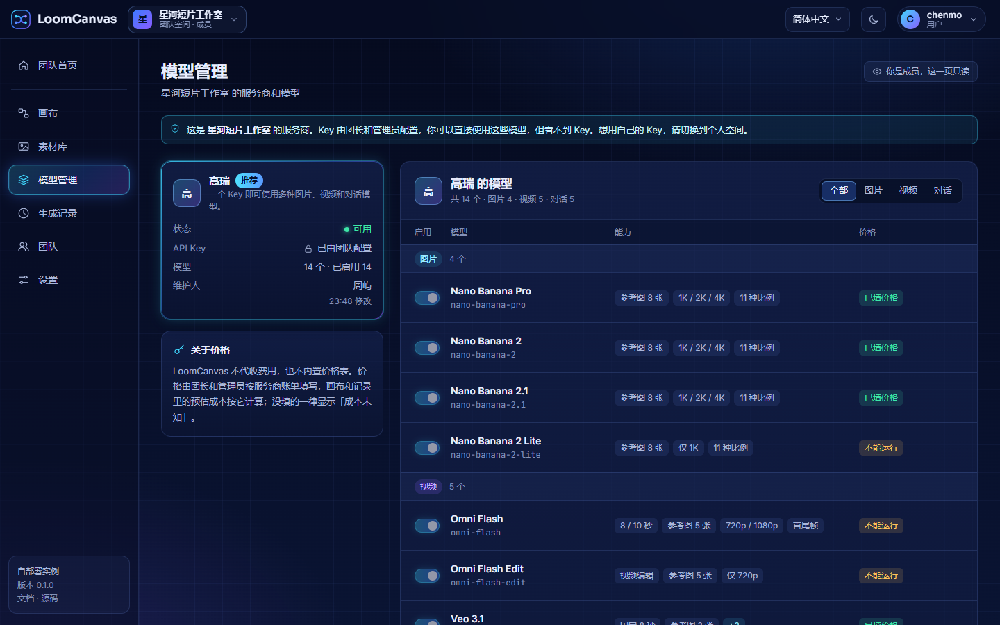

每张服务商卡片上有「维护人」：最后一次改动它（名称、地址、Key、开关、自定义模型）的人和时间，出了问题知道该找谁。维护人已经离开团队或账号已被删除时，名字照旧，后面跟着「已离开团队」或「账号已删除」。

团长和管理员还看得到连接状态：「连接正常」、「上次测试失败」（卡片下方写着原因）或「未测试」，以及上次测试的时间。点「测试连接」后状态立刻更新；换了 Key 或接口地址之后，上一次的结果不再作数，状态回到「未测试」。个人空间的服务商卡片也是这样。

成员看到的这一页是只读的：服务商的名称、状态（「可用」或「不可用」）、「已由团队配置」、维护人，以及模型和价格。**成员看不到 Key、Key 的末几位、接口地址和连接测试的结果**，也没有「测试连接」和「编辑」。成员用得上团队的 Key，但拿不到它。

- 团队空间里只用团队的 Key；你个人的 Key 只在个人空间里用。想用自己的 Key，就切回个人空间。
- 别人的「仅自己」画布，成员和管理员都看不到。
- 全队的生成记录和用量只有团长看得到（团长可以放开给管理员）；其他人只看得到自己的。
- 团队动态只有团长和管理员看得到。

### 创建团队

创建团队要超级管理员授权。空间切换器里显示哪一项取决于你的账号：

- **有授权**：「创建团队」。弹窗里写着你还可以创建几个、每个团队最多多少人；填团队名称，头像可以不选。团队的时区取自你的浏览器，每月上限按它的自然月计算，之后可以在团队设置里改。
- **没有授权**：「申请创建团队」。可以写一句说明再提交，超级管理员会看到。提交后这里显示「等待处理」，可以撤回；同一时间只能有一条待处理的申请。没通过的话会显示原因，可以再次申请。
- 已有授权但已到数量上限时，这里会说明：你创建的或担任团长的团队都算，已解散、还没被永久删除的也算。

加入别人的团队不需要授权，有邀请链接就行。

### 邀请和加入

邀请链接是加入团队的唯一途径，系统不发邮件。在「团队 → 成员」页的「邀请链接」里，团长和管理员可以：

- 「生成新链接」：选有效期（1 / 7 / 30 天，默认 7 天）和可用次数（1 / 10 / 不限，默认 10 次）。链接的样子是 `<站点地址>/join/<邀请码>`；
- 「复制」已有的链接；
- 「撤销」：立即失效，已经加入的人不受影响。

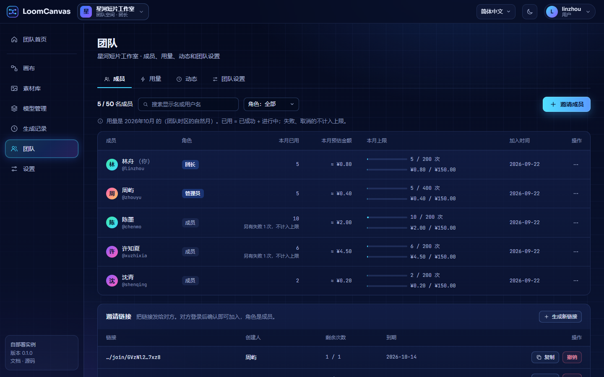

在链接过期、次数用完或被撤销之前，**任何拿到它的人**都可以加入，角色是成员，不需要谁再批准。请把它直接发给本人。

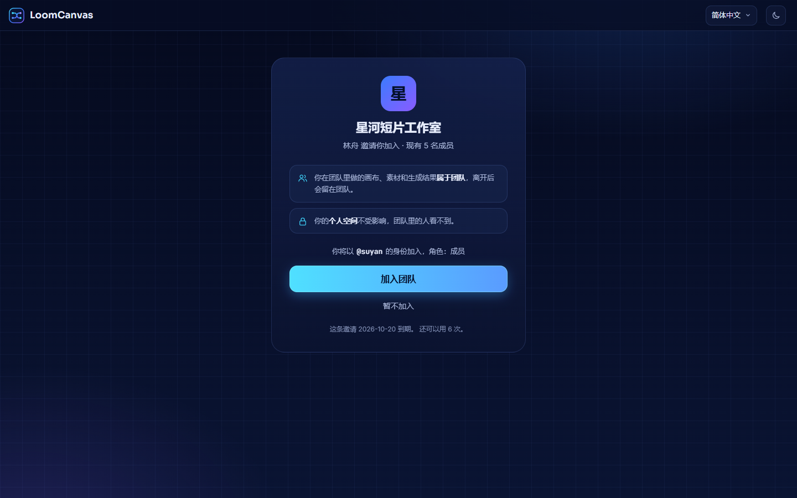

对方打开链接，看到的是加入页：哪个团队、谁邀请的、现有多少成员、链接哪天到期，以及有次数限制的链接「还可以用几次」（不限次数的链接不写）。这一页不用登录就能看，但看不到团队里的任何内容；加入需要先登录。也可以在空间切换器里点「用邀请码加入」，粘贴整条链接或链接最后那一段。

- 站点关闭了注册时，加入页会如实说明，不会提供注册入口：邀请链接不能用来绕过「关闭注册」。
- 链接已过期、次数已用完、已被撤销、团队已满员、团队已关闭，各有各的提示。

### 团队里的画布

团队里的每张画布有一个可见范围：

| 可见范围 | 谁能看 | 谁能改 |
| --- | --- | --- |
| **仅自己** | 创建者和团长 | 创建者和团长 |
| **团队可看** | 所有成员，能打开、看结果、复制一份 | 创建者和团长 |
| **团队可改** | 所有成员 | 所有成员，同一时间一个人 |

无论选哪一档，团长始终看得到。新画布用团队的默认值（一开始是「团队可看」，团长可以在团队设置里改）；创建者、团长和看得到这张画布的管理员可以逐张修改。

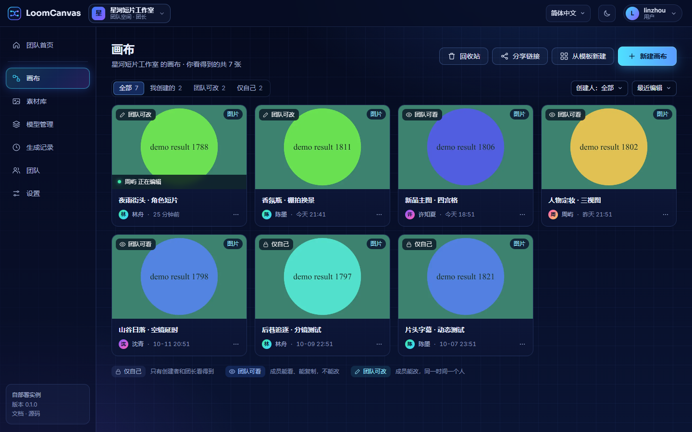

「画布」页在团队里多了这些：

- 筛选：「全部」「我创建的」「团队可改」「仅自己」，以及按创建人筛选；
- 卡片上显示创建人、可见范围，有人在改的时候显示「某某 正在编辑」；
- 卡片菜单：「重命名」「复制一份」「复制到个人空间」（你还在别的团队时是「复制到其他空间…」）「团队权限」「下载」「删除」。「复制一份」得到的副本归你，可见范围是「仅自己」；
- 「回收站」，见[回收站](#回收站)。

这个列表和团队首页上最近的画布，在页面开着的时候会自己跟上：谁正在编辑、改了的名字，以及队友新建、保存、删除、恢复的画布，大约 10 秒内就会出现，不用刷新。

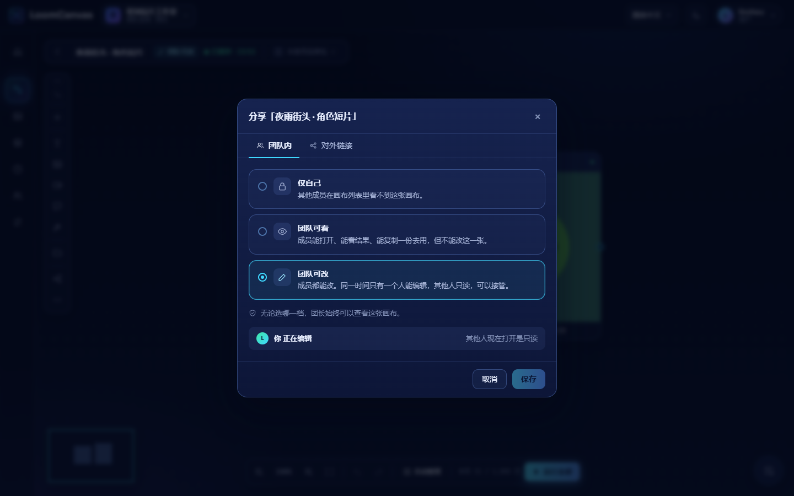

在编辑器里，标题块上显示着这张画布的可见范围。点它打开「分享」弹窗：「团队内」页签里是上面三档，「对外链接」页签是[分享链接](#分享链接)。

### 轮流编辑

同一张团队画布同一时间只有一个人能改。没有多人同时编辑，也没有合并。

**编辑锁。** 谁先打开一张自己能改的画布，谁就拿到编辑锁。锁属于那个打开着的编辑器，也就是那个浏览器标签页，不属于账号：你自己在第二个标签页（或另一台设备）上打开同一张画布，第二个也是只读，提示条写着「你在另一个标签页（或另一台设备）打开了这张画布」，旁边有「在这里编辑」，点了就把编辑挪过来。编辑器每 12 秒续一次锁；离开编辑器、关掉标签页或跳到别的网站的那一刻立刻归还，下一个人不用等。只有没来得及打招呼就没了的标签页（崩溃、断网）会让别人等，最多 36 秒。

**后台标签页。** 切到别的标签页时，编辑器先把没保存的存掉。标签页在后台超过大约五分钟就不再占着画布（浏览器会放慢后台页），免得挡住正在看的人。回来时没人拿走，接着改就行；期间有人开始编辑了，提示条会写「这个标签页在后台停得太久（或断过网），某某 已经开始编辑」。

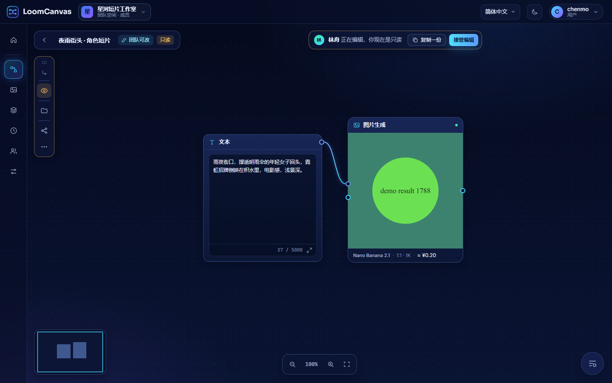

**只读。** 别人拿着锁的时候你打开这张画布，顶上有一条提示「某某 正在编辑，你现在是只读」，旁边是「复制一份」和「接管编辑」。只读状态下什么都不会保存，也不能运行；对方保存的内容几秒内会出现在你这边。对方离开后，大约 5 秒内提示会变成「某某 已经离开，现在没有人在编辑」，并给出「开始编辑」，不用刷新页面。别人的「团队可看」画布你只能查看和复制，没有接管。

这时工具栏换成只读的一套：一圈琥珀色的边，加节点的按钮换成一枚眼睛标记。留下的都是看的和拿走的：「素材库」（浏览、下载；不能上传、删除、加到画布）、「分享与权限（只读）」（团队权限，原来能改的人照样能改；已有的对外链接可以查看和复制，不能创建或撤销）和「更多」（搜索、批量下载、教程、节点布局、切换画布）。节点可以好好地看：点开图片或视频看大图、播放视频、滚动长文字并选中和复制（提示词也可以）、切换查看节点的历史版本、下载结果。选中一个生成节点，输入条或属性面板照样打开，只不过是只读的：能看到提示词、模型、参数和预估成本。会改动画布的一概没有：没有运行，没有能输入的地方，没有可以连线的端口，也不能拖动或删除。点工具栏上的眼睛标记，会用一句话把这些再说一遍。

**改名不算编辑。** 有编辑权的人随时可以给画布改名：列表卡片的菜单、工作台、编辑器里点一下名字都行。别人正在编辑时可以改，自己因此处于只读的编辑器里也可以改。谁都不会被打断：对方的标题几秒内跟着变，并有一条简短提示，对方的下一次保存照常成功。其他人的画布列表和工作台大约 10 秒内显示新名字，不用刷新。只有查看权的人不能改名，鼠标停在名字上会说明原因。

**接管。** 「接管编辑」要求你有这张画布的编辑权，并且要确认一次。被接管的人不会立刻收到通知：他下一次保存或下一次续期时（12 秒内）变成只读。他已经保存的不会丢；还没保存的改动留在他的页面上，可以用「把我的改动另存为副本」留下来。从别人手里接管会记入团队动态；把自己的编辑从一个标签页挪到另一个不记。

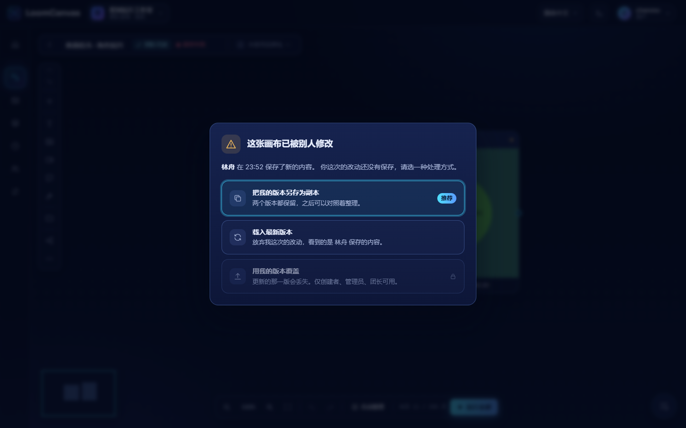

**保存冲突。** 锁挡不住所有情况（锁过期了、被接管了、同一个账号开了两个标签页），所以每次保存还会检查版本。你改的那一版已经不是最新的时，这次保存不会写入，弹出「这张画布已被别人修改」，写着是谁在什么时候保存的，让你选：

- 「把我的版本另存为副本」（推荐）：两个版本都留着，之后对照着整理；
- 「载入最新版本」：放弃你这次的改动；
- 「用我的版本覆盖」：对方的改动会丢。只有画布的创建者、能编辑它的管理员和团长可以用，并且记入团队动态。

个人空间里的画布现在也有这个弹窗：同一张画布开在两个标签页里，后保存的不会再不声不响地盖掉先保存的。

### 每月上限和用量

团长可以按月限制用量，单位有两个：**运行次数**和**预估金额**。各自可以给整个团队设，也可以给成员设：一个全员默认值，加上某个成员单独的值。在「团队 → 团队设置 → 额度」里设团队的和默认的，在「团队 → 成员」里那个人那一行的「⋯」菜单里点「调整上限」，设某个人的。留空表示不限。

- **算什么。** 规则只有一条，凡是出现数字的地方都按它算：**已用 = 已成功 + 进行中**。一次运行从被接受的那一刻起（排队、运行、保存结果）就占着名额，成功之后继续算。**失败和取消的不计入**：运行失败，它占的名额和金额都退回。一条运行记录算一次，不管它出几张图。团队首页、「团队 → 用量」、成员名单和调整某个成员上限的对话框，显示的是同一份数字，失败和取消的都单独列出并写明不计入。
- **月份**是团队时区里的自然月，时区在「团队设置 → 基本信息」里。
- **到了上限**：新的运行被拒绝；已经在排队或运行的不受影响。两项哪个先到算哪个，下个月自动恢复。被拒绝的原因就写在你点「运行」的地方（输入条、属性面板或节点上，批量运行的弹窗里，生成队列清单里），并且一直留着等你看完：**是哪一项上限**（你的还是团队的，次数还是金额）、**具体数字**（已用、上限、这次要占多少）、**什么时候重新开始计数**（按团队时区写的日期和时间）、**该找谁**（团长的名字；缺价格时是团长和管理员）。你自己是团长的话，给的是去设置的入口。某项上限已经用完时，不用点运行就能看到同样的说明，「运行全部」旁边的小计数也会变红。上限对团队里的每个人都生效，包括团长，不影响任何人的个人空间。
- **在哪里看。** 编辑器「运行全部」旁边的小计数、生成队列清单里的「我的本月上限」、团队首页，以及「团队 → 用量」。用到上限的 80% 起显示「接近上限」。「团队 → 用量」最上面那一块永远是**本月**的上限；下面的表格跟着你选的月份走，选的不是本月时会有一行说明。
- **没填价格的模型。** 金额只能按填了价格的模型算。设了金额上限并打开「没填价格的模型禁止运行」（默认打开）时，没有价格、或者价格不是团队所选货币的模型不能在团队里运行，「团队设置 → 额度」里会列出是哪些。关掉这个开关，这类运行只计次数。在编辑器里，这样的模型在模型下拉里标着「不能运行」，选中它时会说明原因，并写出能给它填价格的团长和管理员是谁。
- **预估不是账单。** 金额是按团队在「模型管理」里填的价格算出来的预估，真实账单以上游为准。没有价格的运行显示为**成本未知**，单独计数（「另有 N 次成本未知」），不会算成 0 元。**按 token 计价的对话模型**要跑完才知道成本，所以对话运行开始前先**占一笔预留**：你发出去的内容的价格，加上按最长回答算的价格（默认按 8192 个输出 token，模型自己声明了上限就用它的；这个数服务器的管理员可以改）。跑完之后，预留换成真实成本，通常比预留小得多；失败或取消的运行，预留全部退回。所以金额上限不会被对话运行悄悄超出；也正因为这样，有时真实成本其实放得下、对话运行却被拒绝了：提示里会写明这次要预留多少、现在还剩多少。

完整的规则见[每月上限](api.zh-CN.md#每月上限)。

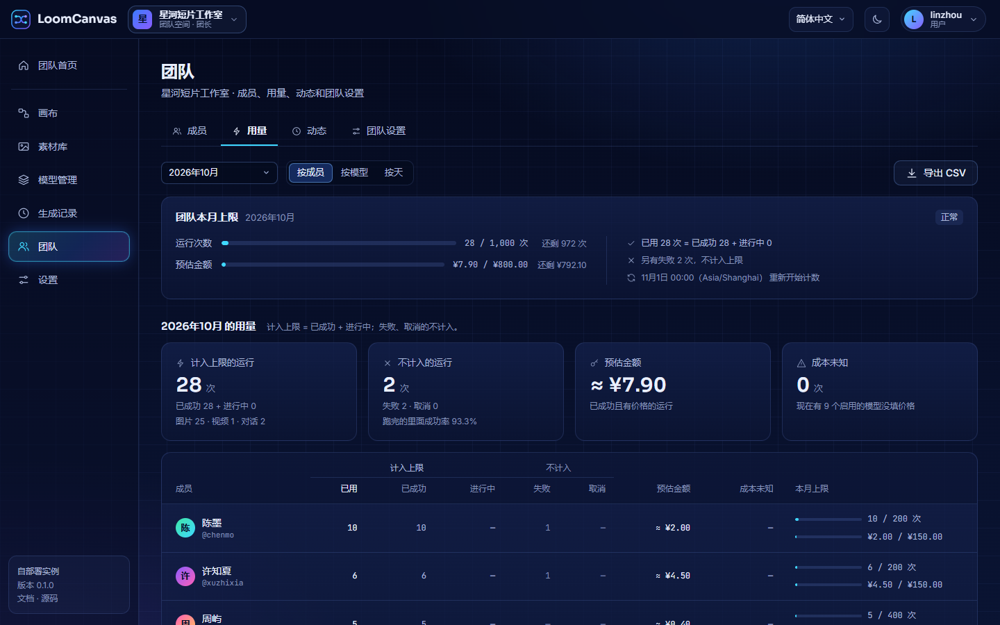

「团队 → 用量」最上面是本月的上限（和团队首页那一块相同）。下面按你选的月份显示：计入上限的运行（已成功 + 进行中）、不计入的运行（失败、取消，附成功率）、预估金额（进行中的运行占着多少会单独写明）、成本未知的次数；表格里「计入上限」和「不计入」分成两组列，看本月时最后一列是每个成员的本月上限。团长可以「按成员」「按模型」「按天」分组，并「导出 CSV」；其他人在这里只看到自己的记录。

### 团队动态

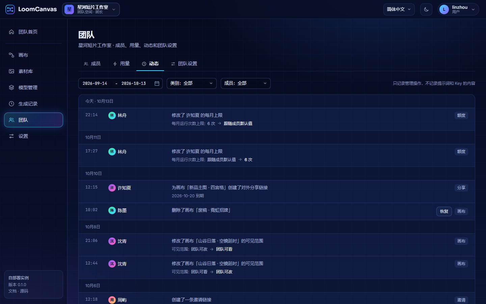

「团队 → 动态」是团队的管理操作记录，团长和管理员可以看：成员加入、退出、被移除、角色和显示名的变更，邀请链接，服务商、Key 和价格的变更，上限，画布的删除、恢复、可见范围、接管和覆盖，分享链接，团队名称、头像和设置，解散和恢复。可以按时间段、类别和成员筛选；被删除的画布可以直接在这里「恢复」。

每一条写明谁、做了什么；改了数值的会写出改之前和改之后，例如「角色：成员 → 管理员」「团队每月运行次数上限：1,000 次 → 1,200 次」「可见范围：仅自己 → 团队可看」「价格：¥0.90/张 → ¥0.60–¥1.60/张（按分辨率，3 档）」。邀请链接会写可用次数和到期日，成员离开时会写名下有几张画布转给了团长。

人名显示的是这个人**现在**在团队里的名字。已经离开团队的人名字照旧，后面标「已离开团队」；账号被删除的标「账号已删除」。超级管理员从团队外面做的事（停用团队、指定新团长、删除某个成员的账号）记在「超级管理员」名下。

它只记管理操作，不记日常创作（保存画布、运行模型都不在里面），也不含提示词、Key 的内容和接口地址。任何人都改不了、删不掉其中的记录；保留多久由超级管理员设置（默认 365 天）。

### 团队设置

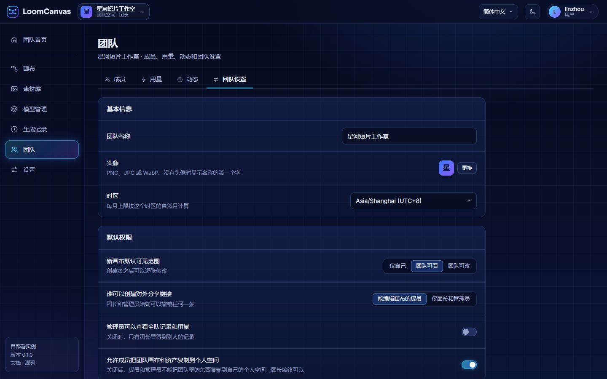

「团队 → 团队设置」只有团长和管理员看得到。管理员能改的只有团队名称和头像，其余由团长决定。

| 卡片 | 有什么 |
| --- | --- |
| **基本信息** | 团队名称、头像、时区（每月上限按这个时区的自然月计算）。 |
| **默认权限** | 「新画布默认可见范围」；「谁可以创建对外分享链接」（能编辑画布的成员，或仅团长和管理员）；「管理员可以查看全队记录和用量」；「允许成员把团队画布和资产复制到个人空间」。 |
| **额度** | 「团队每月上限」和「成员默认每月上限」，各有次数和预估金额两项；「货币」；「没填价格的模型禁止运行」。 |
| **危险操作** | 「转让团长」「解散团队」。 |

### 退出、移除、转让和解散

**退出。** 在「团队 → 成员」里点自己那一行末尾的「⋯」，选「退出团队」。**移除**别人是对方那一行同一个菜单里的「移除」：团长可以移除任何人，管理员只能移除成员。两种情况结果一样：

- 这个人立刻进不了团队空间；
- 他做的画布、素材和结果留在团队；
- 他的「仅自己」画布转给团长，否则没人进得去；
- 他排队中的运行被取消，已经开始的会跑完；
- 他创建的邀请链接全部失效；
- 想回来需要一条新的邀请链接。

移除的是一位填写过服务商 Key 的管理员时，界面会列出涉及哪些服务商：这个人知道那些 Key，请到上游把它们换掉，再到「模型管理」里更新。成员从没见过 Key，不需要换。

**团长不能直接退出。** 团队必须有一位团长：先「转让团长」，或者「解散团队」。两项都在「团队设置 → 危险操作」里，都要输入准确的团队名称确认。

- **转让团长**：选一名现有成员接任，你变成管理员。这一步你自己撤不回来。
- **解散团队**：所有人立刻进不去，排队中的运行被取消，邀请链接和分享链接失效。这时什么都还没删：**7 天内**团长可以在空间切换器里恢复它，超级管理员也可以恢复。过了 7 天，团队的画布、素材、Key、记录和文件被永久删除，无法找回。

**正在用的时候被移出、团队被解散或被停用**：你的下一个操作会把你送回个人空间，并弹出一个提示，说明是这三种情况里的哪一种。

### 在空间之间复制

画布和资产可以复制到你所在的另一个空间：

- 个人空间的「画布」页：卡片上的「复制到团队…」；
- 团队的「画布」页：卡片菜单里的「复制到个人空间」或「复制到其他空间…」；
- 「素材库」页：选中一条资产，点「复制到…」。

复制的规则：

- **文件一起复制。** 画布引用的每个文件都在目标空间里另存一份，之后两边互不影响。一次最多 300 个文件、共 2 GiB。
- 复制到团队的画布归你创建，默认「仅自己」，之后可以改可见范围；复制到团队的资产进入团队的素材库，全队都能用。
- **品牌包不带过去。** 目标空间里没有的模型，节点上会要求重新选择。
- 团长可以在团队设置里关掉「允许成员把团队画布和资产复制到个人空间」。关掉之后成员和管理员不能把团队的东西复制到自己的个人空间；团长始终可以，复制到你所在的另一个团队也不受影响。
- 「复制到…」的弹窗列出你所在的**每一个**空间。去不了的也在里面，灰着，下面写着原因：团长关闭了复制到个人空间、那个团队已被停用或已经解散、那个空间里这一类素材已经放满，或者它就是你现在所在的空间。

### 回收站

删除的画布先进回收站，30 天内可以恢复，过期后自动清除。入口是「画布」页顶部的「回收站」。

- 个人空间：你自己恢复。
- 团队空间：只有团长和管理员看得到「回收站」、可以恢复；成员删除自己的画布后，要找他们恢复。

## 快捷键

macOS 上用 ⌘ 代替 Ctrl。

| 按键 | 作用 |
| --- | --- |
| Ctrl+Z | 撤销 |
| Ctrl+Shift+Z、Ctrl+Y | 重做 |
| Ctrl+A | 全选 |
| Ctrl+C、Ctrl+V | 复制、粘贴节点，连同它们之间的连线 |
| Ctrl+D | 原地复制选中的节点 |
| Delete、Backspace | 删除选中 |
| Ctrl+S | 保存 |
| Ctrl+0 | 适应视图 |
| Ctrl+F | 节点搜索 |
| Ctrl+G | 成组 |
| Ctrl+Shift+G | 解散 / 移出组 |
| Shift + 拖动 | 框选 |
| Ctrl + 点击 | 把节点加进选区，或从选区里去掉 |
| Ctrl+Enter | 光标在提示词里时：运行这个节点 |
| Esc | 关闭菜单；收起输入条或属性面板（节点仍然选中） |

## 语言与外观

- **语言**：顶栏的下拉（窗口窄于 760px 时是账号菜单里的「语言」），或者「设置 → 外观」里的「界面语言」，在简体中文和 English 之间切换。服务端给出的提示也跟着这个语言走。这个选择按浏览器记住；没选过之前，用的是超级管理员在「设置 → 外观」里设的「默认语言」。
- **节点布局**：「设置 → 外观」里的三选一，决定画布上生成节点的样子，见[生成](#生成调用付费模型)。它存在你的账号上，不是浏览器里。
- **主题**：深色（默认）、浅色，或者跟随系统（设备是深色就用深色，变了自动跟着变）。点三张预览卡里的一张，立刻生效，不用刷新。选择跟着账号走，换一台设备登录也是它；这台浏览器也会记住，登录页和分享页用的是同一个主题。顶栏上语言菜单旁边的图标也能切；落地页、登录页、注册页、分享页、「页面不存在」和「连接不上服务端」这几屏上有同一个图标，在那里选的先记在浏览器里，登录之后存到你的账号上。在那里什么都没选、浏览器上的主题又和账号上的不一样时（比如换了一台新浏览器），登录不会闪一下：登录页保持原样，应用打开的第一帧就是你账号的主题。
- **画布外观**（更多 ⋯ 或右键）：单张画布的底色、图案和密度。它跟着画布一起保存，也跟着分享链接走。底色留在默认档时，画布跟看的人的主题走；自己选的底色在两种主题下都不变，连线、组的虚线框、图案和小地图按这个底色的明暗取色。

浅色主题下的团队首页和落地页：

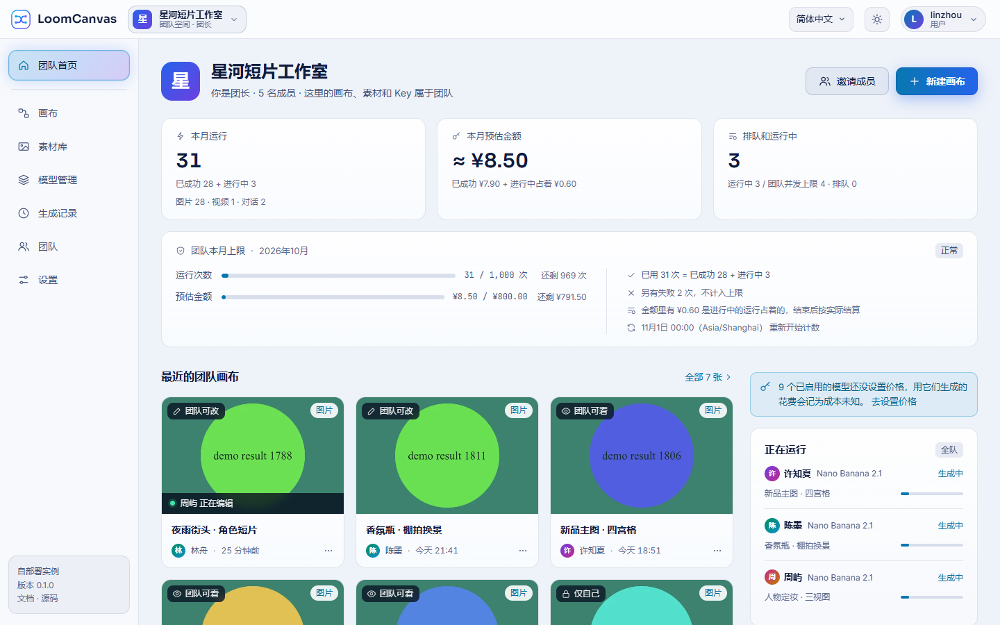

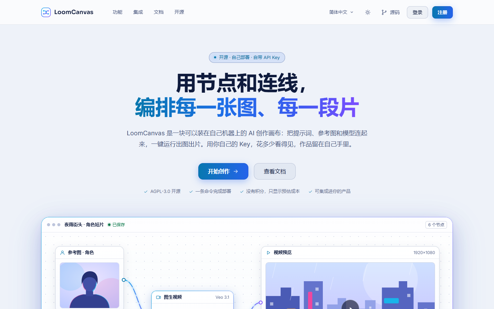

## 值得知道的上限

| 上限 | 值 |
| --- | --- |
| 在画布里上传，每个文件 | 服务端的 `MAX_UPLOAD_MB`（默认 50 MB）。画布从服务端读到这个上限，超过的文件在上传前就会被拦下。 |
| 文件类型 | 图片和视频，按内容识别，不看文件名 |
| 每次运行的参考图 | 不超过所选模型的上限，多出来的会被略去并给出提示 |
| 恢复已删除的画布 | 30 天内 |
| 恢复已解散的团队 | 7 天内 |
| 团队画布的编辑锁 | 每个打开着的编辑器（标签页）一把。最后一次续期后 36 秒失效；编辑器每 12 秒续一次，关掉标签页时立刻归还。只读的编辑器每 5 秒看一次画布有没有空出来；画布列表和工作台每 10 秒刷新一次「谁正在编辑」和画布名 |
| 跨空间复制时一起复制的文件 | 300 个，共 2 GiB |
| 自存的模板、提示词片段 | 每个空间各 200 个 |

每个团队最多多少人、每人最多创建几个团队由超级管理员设置；其余的上限见[配置](configuration.zh-CN.md#固定上限)。

更多问题见[常见问题](faq.zh-CN.md)。
